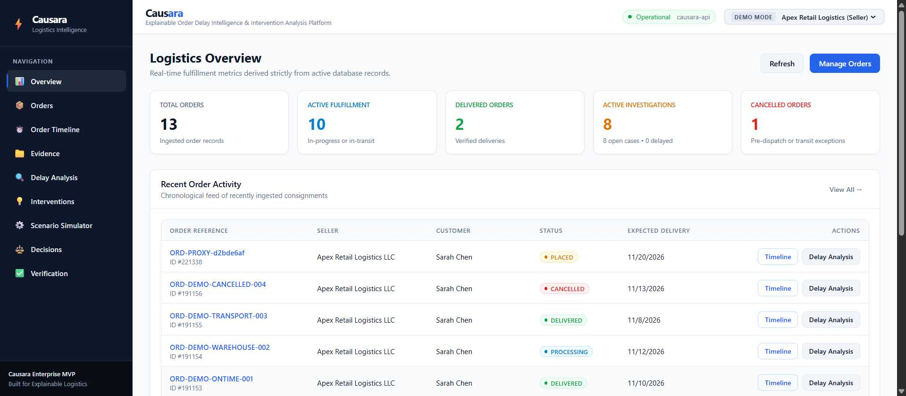
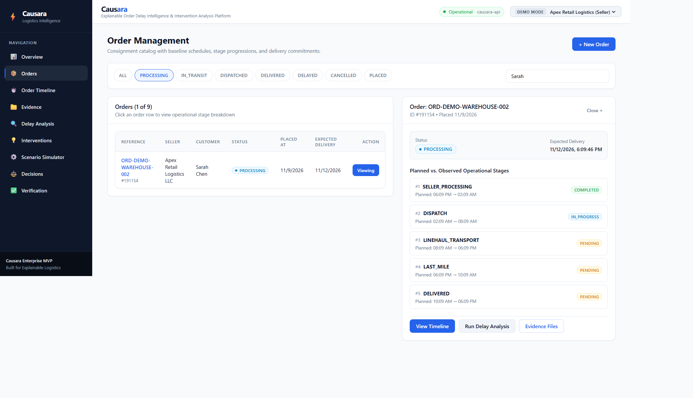
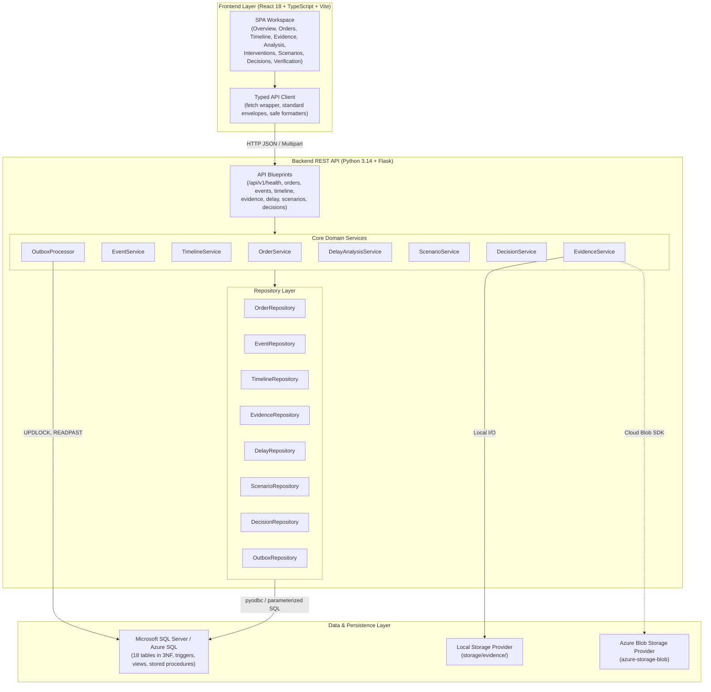

# CAUSARA

> **Explain Delays. Discover Interventions. Improve Decisions.**

Causara is an explainable e-commerce order delay intelligence and intervention analysis platform. Instead of treating e-commerce shipping delays as opaque, single-metric failures, Causara chronologically reconstructs the end-to-end journey of an order across distinct operational stages, isolates where variances occurred, evaluates possible counterfactual interventions, records traceable management decisions, and mathematically verifies predictions against observed delivery outcomes.

---

## Visual Tour

### Operational Intelligence Dashboard
Real-time fulfillment metrics, open investigation cases, and recent order activity connected to live database queries:



### Order Stage Timeline & Duration Variances
Visual stage progression with planned vs. actual duration calculations and chronological event logging:



---

## The Problem Causara Solves

In conventional e-commerce logistics, tracking systems suffer from critical structural limitations:

1. **Opaque Aggregation**: When an order is overdue, customers and sellers typically see a generic notice such as *"Delayed in transit"*. This hides whether the failure originated during warehouse picking, courier dispatch, linehaul transport, or local hub delivery.
2. **Conflating Correlation with Causation**: Traditional dashboards often blame whichever logistics provider handled the parcel last, ignoring compounding upstream bottlenecks (e.g., a 26-hour warehouse packing delay that caused an order to miss a scheduled regional linehaul flight).
3. **Unverified Interventions**: When sellers take corrective action (such as paying for courier priority upgrades or dispatching duplicate packages), there is rarely a structured system to measure whether the intervention actually recovered time.
4. **Absence of Traceable Governance**: Operations managers lack structured audit trails documenting why specific expediting actions were chosen, what assumptions were made, and who approved the operational cost.

---

## Causara's Approach: Epistemological Guardrails

Causara separates data into strict epistemological categories to prevent correlation from being presented as proven causation:

- **Observed Facts**: Immutable, timestamped events directly recorded by warehouse scanners, courier webhooks, or operators (e.g., *“Packing completed at 09:39 UTC”*).
- **Duration Variances**: Arithmetic deviations between planned SLA duration and observed elapsed duration for a specific stage (e.g., *“Seller processing stage exceeded planned baseline by 1560 minutes”*).
- **Hypotheses**: Plausible causal relationships formulated from event sequences (e.g., *“Warehouse picking delay compressed the dispatch buffer, triggering a missed flight cutoff”*).
- **Estimates**: Quantified projections of counterfactual intervention options (e.g., *“Priority packing is estimated to save 240 minutes at an estimated cost of $25.00 with 88% confidence”*).
- **Verified Outcomes**: Mathematical comparison of predicted delivery timestamps against observed delivery timestamps, calculating signed error ($E_{\text{signed}}$) and absolute error ($E_{\text{abs}}$) without data fabrication.

---

## Key Features

1. **Order Lifecycle Management**: Tracks orders from placement to terminal delivery, linking external references, seller profiles, customer records, and sequential fulfillment stages.
2. **Idempotent Event Ingestion**: Ingests physical event updates with dual-timestamp recording (`occurred_at` vs. `received_at`), schema validation, and replay prevention via unique idempotency keys.
3. **Timeline Reconstruction**: Deterministically compiles out-of-order and asynchronous events into an ordered timeline, computing stage-by-stage planned vs. actual variances.
4. **Documentary Evidence Management**: Stores physical documents (incident logs, handover receipts, photos) with SHA-256 cryptographic digests, cross-order referential isolation, and pluggable storage providers.
5. **Delay Analysis & Propagation Graphs**: Identifies primary bottleneck stages and synthesizes directed delay propagation graphs distinguishing physical transitions from bottleneck propagation hypotheses.
6. **Candidate Intervention Discovery**: Discovers applicable remediation strategies across operational domains (warehouse, packaging, carrier rerouting, customer communication) based on active bottleneck stages.
7. **Counterfactual Scenario Simulation**: Simulates alternative remediation scenarios, comparing predicted time saved, financial costs, risk ratings, and model confidence scores.
8. **Operational Decision Workflow**: Captures seller remediation proposals with documented rationales and enforces human-in-the-loop approval workflows for operations managers.
9. **Outcome Verification Engine**: Benchmarks executed decisions against actual delivery events to compute prediction variance, ensuring complete closed-loop feedback.

---

## System Architecture



---

## Technology Stack

### Frontend
- **Framework**: [React 18](https://react.dev/) (`18.3.1`)
- **Language**: [TypeScript](https://www.typescriptlang.org/) (`5.4.5`) with strict mode
- **Build Tool**: [Vite](https://vitejs.dev/) (`5.2.0`)
- **Testing**: [Vitest](https://vitest.dev/) (`1.4.0`) and [React Testing Library](https://testing-library.com/)
- **Styling**: Modular CSS with scoped CSS variables (dark navy sidebar, light workspace palette)

### Backend
- **Framework**: [Flask](https://flask.palletsprojects.com/) (`>=3.1.0`)
- **Language**: [Python](https://www.python.org/) 3.14+
- **CORS**: [Flask-CORS](https://flask-cors.readthedocs.io/) (`>=5.0.0`)
- **Database Driver**: [pyodbc](https://mkleehammer.github.io/pyodbc/) (`>=5.3.0`)
- **Storage SDK**: [azure-storage-blob](https://pypi.org/project/azure-storage-blob/) (`>=12.19.0`)
- **Environment**: [python-dotenv](https://github.com/theskumar/python-dotenv) (`>=1.0.1`)

### Database & Storage
- **Relational Store**: [Microsoft SQL Server](https://www.microsoft.com/sql-server) (LocalDB for local development; Azure SQL Database support via connection string configuration)
- **Schema Management**: Custom version-controlled SQL migration runner with SHA-256 checksum auditing (`database/migration_runner.py`)
- **Object Storage**:
  - `LocalStorageProvider`: File storage under `storage/evidence/` for local development.
  - `AzureBlobStorageProvider`: Cloud storage integration via Azure Blob Storage SDK.

### Testing & Code Quality
- **Unit & Integration Tests**: [pytest](https://docs.pytest.org/) (`9.2.0`)
- **Linter**: [flake8](https://flake8.pycqa.org/)

---

## Getting Started

### Prerequisites
- **Python**: Version 3.14.x (or 3.11+)
- **Node.js**: Version 20.x or 24.x LTS
- **npm**: Version 10.x or 11.x
- **Database**: Microsoft SQL Server Express LocalDB (Windows) or an accessible SQL Server 2019/2022 instance
- **ODBC Driver**: Microsoft ODBC Driver 17 or 18 for SQL Server
- **OS**: Windows (PowerShell commands provided below) or Linux/macOS

---

### Step-by-Step Installation

#### 1. Clone the Repository
```powershell
git clone https://github.com/Akshat-240/CAUSARA-.git
cd CAUSARA-
```

#### 2. Set Up Python Virtual Environment
```powershell
python -m venv .venv
.\.venv\Scripts\Activate.ps1
```

#### 3. Install Backend Dependencies
```powershell
pip install -r requirements.txt -r requirements-dev.txt
```

#### 4. Configure Backend Environment
Copy the example environment template to `.env`:
```powershell
Copy-Item .env.example .env
```
*(By default, `.env` is configured for local development using LocalDB and local storage.)*

#### 5. Initialize the Local Database
Ensure your SQL Server LocalDB instance is running and the database exists:
```powershell
sqllocaldb create CausaraDB
sqllocaldb start CausaraDB
sqlcmd -S "(localdb)\CausaraDB" -Q "IF DB_ID('CausaraDB') IS NULL CREATE DATABASE CausaraDB;"
```

#### 6. Apply Database Migrations
Execute the automated migration runner to apply the 18-table schema, stored procedures, triggers, and views:
```powershell
python -m database.migration_runner status
python -m database.migration_runner migrate
```

#### 7. Seed Demonstration Cases
Load the four standard test orders and operational scenario data:
```powershell
python -m database.seed_demo_data
```

#### 8. Start the Flask Backend
```powershell
python run.py
```
The REST API starts at `http://localhost:5000`. You can verify health via:
[`http://localhost:5000/api/v1/health`](http://localhost:5000/api/v1/health)

#### 9. Set Up and Start the Frontend
Open a new terminal window:
```powershell
cd frontend
npm install
npm run dev
```
The application UI opens at `http://localhost:5173`. The Vite development server automatically proxies API requests to the Flask backend.

---

## Database Configuration

Causara supports two database configurations:

### Option A: Local Development (SQL Server LocalDB)
- **Engine**: Microsoft SQL Server LocalDB (`(localdb)\CausaraDB`).
- **Authentication**: Windows Integrated Security (`DB_TRUSTED_CONNECTION=yes`).
- **Driver**: `ODBC Driver 17 for SQL Server` (or Driver 18).
- **Default Port / Connection**: Local named pipes managed by LocalDB.

### Option B: Cloud Database (Azure SQL Database)
Developers can configure Causara to connect to an Azure SQL Database instance:
1. Create an Azure SQL Database (Serverless General Purpose or Basic tier) in the Azure Portal.
2. In the database networking settings, enable *"Allow Azure services and resources to access this server"* and add your client IP address to the firewall rules.
3. In your `.env` file, set `AZURE_SQL_CONNECTION_STRING` to your Azure SQL ODBC connection string:
   ```ini
   AZURE_SQL_CONNECTION_STRING=Driver={ODBC Driver 18 for SQL Server};Server=tcp:<your-server>.database.windows.net,1433;Database=causara-db;Uid=causara-admin;Pwd=YourSecurePassword!;Encrypt=yes;TrustServerCertificate=no;Connection Timeout=30;
   ```
4. Run migrations against Azure SQL:
   ```powershell
   python -m database.migration_runner migrate
   ```

> [!NOTE]
> Azure SQL connection handling, parameterized queries, and T-SQL compatibility are implemented in code. However, a live cloud deployment of Azure SQL has not yet been verified in production staging. Causara currently runs locally.

---

## Demonstration Data

The seed script (`database/seed_demo_data.py`) populates four realistic logistics scenarios:

| Order Reference | Internal ID | Status | Scenario Description |
|---|---|---|---|
| `ORD-DEMO-ONTIME-001` | `#191153` | `DELIVERED` | Baseline smooth order traversing all 5 stages within planned SLAs without delay. |
| `ORD-DEMO-WAREHOUSE-002` | `#191154` | `PROCESSING` | **Warehouse Bottleneck**: Packaging delayed by `+1560 minutes`. Features attached incident log (`#80054`), synthesized delay graph, simulated counterfactual scenario (`#100097`), and approved decision (`#80076`). |
| `ORD-DEMO-TRANSPORT-003` | `#191155` | `DELIVERED` | **Transit Bottleneck**: Courier linehaul delay with road disruption, delivery variance calculations, and recorded decision. |
| `ORD-DEMO-CANCELLED-004` | `#191156` | `CANCELLED` | Pre-dispatch cancellation event sequence with clean stage termination. |

To safely reset or re-seed data at any time:
```powershell
python -m database.seed_demo_data
```

---

## API Documentation Summary

The Flask backend exposes RESTful endpoints under `/api/v1`. Comprehensive payload contracts, error models, and examples are documented in [05-api-specification.md](docs/05-api-specification.md).

| Endpoint Group | Method | Path | Description |
|---|---|---|---|
| **Health** | `GET` | `/api/v1/health` | Service status, API version, and live database ping. |
| **Orders** | `GET` | `/api/v1/orders` | Paginated catalog with seller, customer, and status filtering. |
| | `POST` | `/api/v1/orders` | Ingest a new order with auto-generated fulfillment stages. |
| | `GET` | `/api/v1/orders/{id}` | Detailed order metadata and stage progression. |
| | `GET` | `/api/v1/orders/stats` | High-level fulfillment counts and active case metrics. |
| **Events** | `POST` | `/api/v1/events` | Ingest chronological logistics events with idempotency keys. |
| **Timeline** | `GET` | `/api/v1/orders/{id}/timeline` | Reconstructed chronological event log with SLA metrics. |
| | `POST` | `/api/v1/orders/{id}/timeline/reconstruct` | Trigger explicit timeline reconstruction job. |
| **Evidence** | `POST` | `/api/v1/orders/{id}/evidence` | Register evidence metadata or upload file attachments. |
| | `GET` | `/api/v1/orders/{id}/evidence` | List evidence attachments associated with an order. |
| | `GET` | `/api/v1/evidence/{id}` | Retrieve individual evidence document metadata. |
| **Delay Analysis** | `GET` | `/api/v1/orders/{id}/delay-analysis` | Bottleneck stage diagnostics and epistemological breakdown. |
| **Interventions** | `GET` | `/api/v1/cases/{case_id}/interventions` | Retrieve discovered candidate interventions for an open case. |
| **Scenarios** | `GET` | `/api/v1/cases/{case_id}/scenarios` | List simulated counterfactual scenarios. |
| | `POST` | `/api/v1/cases/{case_id}/scenarios` | Simulate a new intervention scenario. |
| **Decisions** | `GET` | `/api/v1/cases/{case_id}/decisions` | List recorded operational intervention decisions. |
| | `POST` | `/api/v1/cases/{case_id}/decisions` | Record a decision to execute an intervention scenario. |
| | `POST` | `/api/v1/decisions/{id}/approve` | Operations Manager approval or rejection of a decision. |
| **Verification** | `GET` | `/api/v1/decisions/{id}/verification` | Retrieve outcome verification and error deltas. |
| | `POST` | `/api/v1/decisions/{id}/verification` | Record actual delivery outcome and compute prediction error. |

---

## Automated Testing & Quality Checks

### Run Backend Test Suite (Pytest)
```powershell
pytest tests/ -v
```
*Current test suite: **121 passed** across database constraints, transactions, outbox concurrency, delay graph analysis, evidence validation, and API routes.*

### Run Frontend Test Suite (Vitest)
```powershell
npm test --prefix frontend -- --run
```
*Current test suite: **12 passed** across safe numeric formatters, fallback handlers, and application rendering.*

### Verify Frontend Production Build
```powershell
npm run build --prefix frontend
```
*Compiles strict TypeScript and generates optimized production assets with zero errors.*

### Run Python PEP 8 Linter (Flake8)
```powershell
flake8 app database tests --max-line-length=120
```
*Clean execution with zero linting warnings or errors.*

---

## Important Project Limitations

To maintain transparency, the following items are acknowledged as intentionally scoped for post-MVP delivery:

1. **User Authentication & Role-Based Access Control (RBAC)**: Currently, the application operates in demonstration mode using an Actor Switcher dropdown. JWT issuance, refresh tokens, and server-side RBAC enforcement are documented in the [Deferred Work Checklist](docs/DEFERRED-WORK-CHECKLIST.md) (Milestone M3).
2. **Live Cloud Staging**: Connection abstractions for Azure SQL and Azure Blob Storage are implemented and tested with unit mocks, but a live cloud environment has not been provisioned.
3. **Local Evidence Storage**: In local development, uploaded files are stored on the local disk under `storage/evidence/`. When deployed to ephemeral cloud containers, an external storage account (e.g. Azure Blob Storage) must be configured.
4. **Outbox Processor Background Daemon**: The transactional outbox engine (`OutboxProcessor`) is fully implemented with atomic leases (`UPDLOCK, READPAST`) and retry backoffs, but runs on-demand or via tests rather than a standalone continuous background daemon.
5. **Machine Learning Models**: Delays and variances are currently calculated using deterministic rule engines and historical baseline comparisons; trained regression/GBDT models are planned for future milestones.

For a comprehensive inventory of planned enhancements, refer to [docs/DEFERRED-WORK-CHECKLIST.md](docs/DEFERRED-WORK-CHECKLIST.md).

---

## Project Documentation Index

- [01. Project Overview](docs/01-project-overview.md) — System purpose, problem statement, and system roles.
- [02. Requirements Analysis](docs/02-requirements.md) — Functional (FR-01 to FR-18) and non-functional requirements.
- [03. System Architecture](docs/03-system-architecture.md) — High-Level Design (HLD) and Low-Level Design (LLD).
- [04. Database Design](docs/04-database-design.md) — 18-table 3NF schema, ER diagrams, triggers, and views.
- [05. API Specification](docs/05-api-specification.md) — Complete REST v1 request and response schemas.
- [06. Security & Scalability Design](docs/06-security-design.md) — Defense-in-depth, cryptographic hashing, and data isolation.
- [07. Deployment Design](docs/07-deployment-design.md) — Topology, container specifications, and cloud architecture.
- [Deferred Work Checklist](docs/DEFERRED-WORK-CHECKLIST.md) — Prioritized roadmap for post-MVP hardening.
- [Final Browser Acceptance Report](docs/FINAL-BROWSER-ACCEPTANCE-REPORT.md) — Verification of browser workflows and fixes.

---

## License

No license has been specified for this project. All rights reserved.
