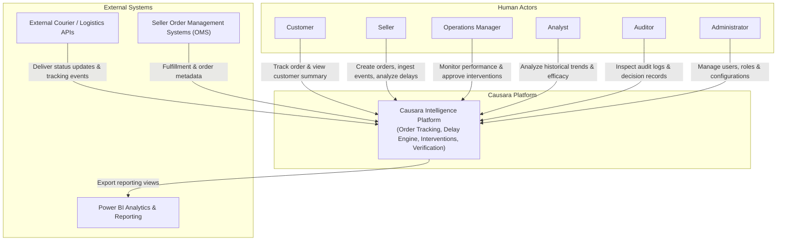
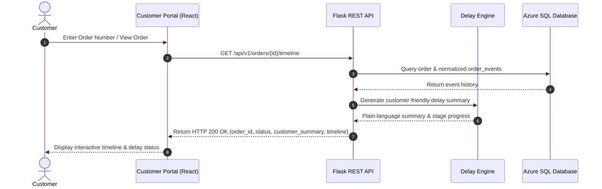
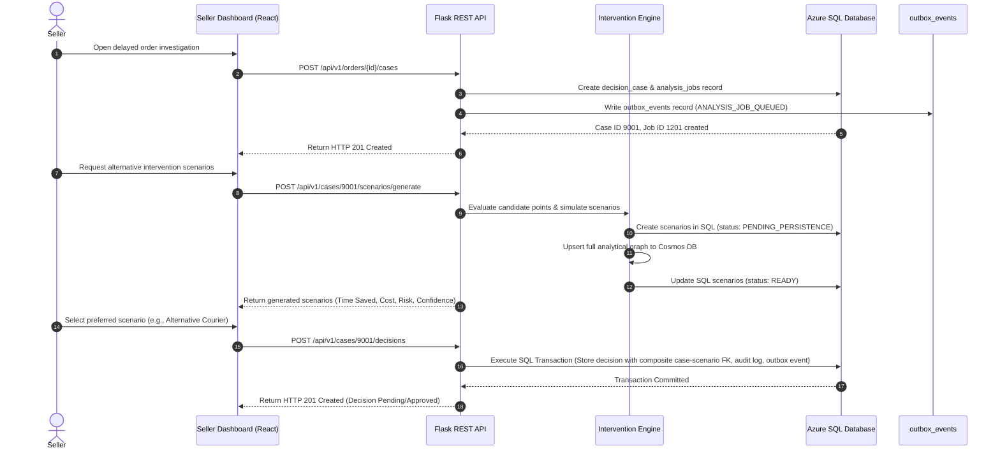
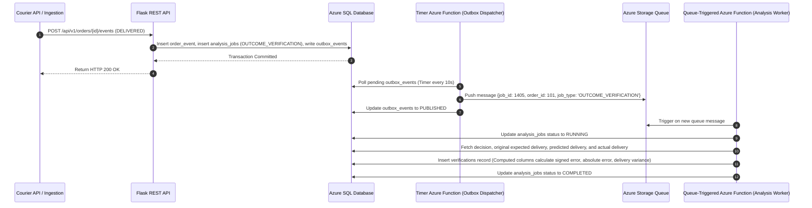
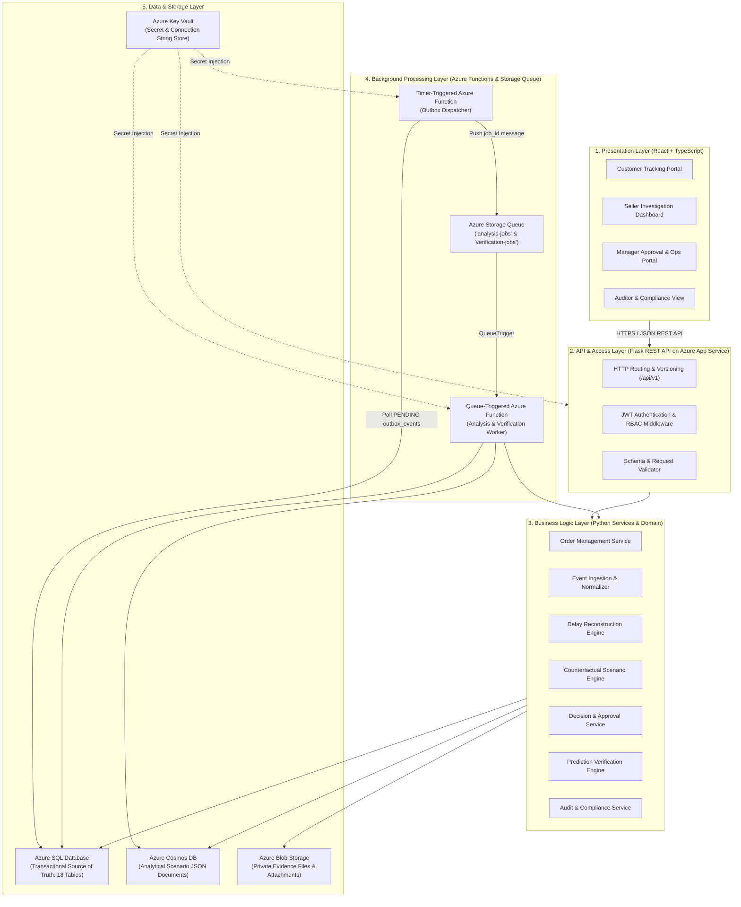
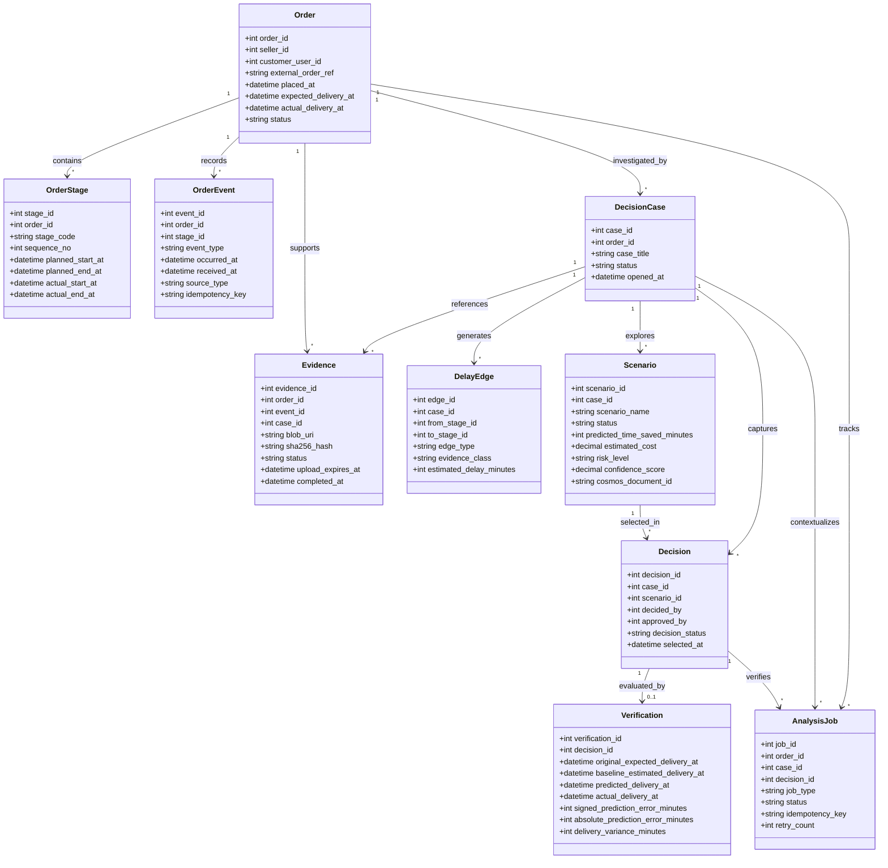

# 03. System Architecture (HLD & LLD)

## 1. System Context & Boundaries

At the boundary level, Causara acts as an intelligent reasoning and intervention layer situated between e-commerce participants and external logistics providers.

### 1.1 Context Diagram



### 1.2 System Boundary Matrix

| Inside Causara Logical Boundary | Outside Causara Logical Boundary |
|---|---|
| User identity, authentication, and RBAC | Courier linehaul and fleet tracking hardware |
| Order lifecycle management and stage definitions | Physical package handling, sorting, or transportation |
| Event ingestion, normalization, and deduplication | Third-party ERP / Inventory databases |
| Delay reconstruction and stage-wise variance calculation | Direct courier driver routing and dispatch |
| Counterfactual scenario simulation and comparison | Commercial external identity providers |
| Decision capture, approval workflows, and audit logging | Power BI reporting visualization canvas |
| Outcome verification against actual delivery events | Physical execution of real-world interventions |

---

## 2. Core System Sequence Workflows

### 2.1 Use Case 1: Customer Tracks a Delayed Order



> **Customer Summary Boundary**: The `customer_summary` is a plain-language explanation generated strictly for the consumer. It omits internal supplier fault attribution, hypothetical root causes, confidential cost figures, and sensitive carrier negotiations.

---

### 2.2 Use Case 2: Seller Investigates Delay & Selects Intervention



---

### 2.3 Use Case 3: Empirical Decision Verification via Azure Functions



---

## 3. High-Level Design (HLD)

Causara adopts a **Modular Monolith Architecture** organized across five distinct logical layers.

### 3.1 Five-Tier Layered Architecture



---

## 4. Low-Level Design (LLD)

### 4.1 Backend Module Hierarchy

```
causara/
│
├── app/                            # Core Monolith Application (API & Domain)
│   ├── __init__.py                 # Application factory & extension setup
│   │
│   ├── controllers/                # HTTP route definitions & request mapping
│   │   ├── auth_controller.py
│   │   ├── order_controller.py
│   │   ├── event_controller.py
│   │   ├── analysis_controller.py
│   │   ├── decision_controller.py
│   │   ├── verification_controller.py
│   │   └── evidence_controller.py
│   │
│   ├── services/                   # Application orchestration & transactions
│   │   ├── auth_service.py
│   │   ├── order_service.py
│   │   ├── event_service.py
│   │   ├── delay_service.py
│   │   ├── intervention_service.py
│   │   ├── decision_service.py
│   │   └── verification_service.py
│   │
│   ├── domain/                     # Pure business logic & algorithms
│   │   ├── models/                 # Pure domain entities (Order, Event, Scenario)
│   │   ├── algorithms/             # Delay reconstruction & counterfactual simulators
│   │   └── validators/             # Business rule validators
│   │
│   ├── repositories/               # SQL abstraction & data access objects
│   │   ├── user_repository.py
│   │   ├── order_repository.py
│   │   ├── event_repository.py
│   │   ├── case_repository.py
│   │   ├── decision_repository.py
│   │   ├── job_repository.py
│   │   └── audit_repository.py
│   │
│   ├── integrations/               # Cloud & external client adapters
│   │   ├── azure_sql/              # DB connection pooling & raw query helpers
│   │   ├── cosmos_db/              # Scenario document client
│   │   ├── blob_storage/           # SAS token generation & upload helpers
│   │   └── storage_queue/          # Queue publisher & consumer
│   │
│   └── security/                   # Crypto, hashing, and JWT tokens
│       ├── tokens.py
│       ├── password.py
│       └── rbac.py
│
├── functions/                      # Azure Functions App (Background Processing)
│   ├── host.json                   # Azure Functions runtime configuration
│   ├── local.settings.json         # Local development settings (Azurite)
│   ├── outbox_dispatcher/          # Timer-triggered function (polls SQL outbox -> Storage Queue)
│   │   ├── __init__.py
│   │   └── function.json
│   └── queue_processor/            # Queue-triggered function (consumes Storage Queue -> executes jobs)
│       ├── __init__.py
│       └── function.json
│
├── tests/                          # Pytest suite (unit, integration, contracts)
├── migrations/                     # Version-controlled SQL DDL scripts
├── requirements.txt
└── run.py
```

---

### 4.2 Normalized Event Data Structure

Disparate event inputs are normalized into the following internal structure:

```json
{
  "order_id": 101,
  "stage_code": "TRANSPORT",
  "event_type": "HUB_DEPARTURE",
  "occurred_at": "2026-11-04T10:30:00Z",
  "received_at": "2026-11-04T10:35:12Z",
  "source_type": "COURIER_API",
  "source_provider": "BlueDart",
  "source_event_id": "BD-882910-E2",
  "idempotency_key": "bluedart-101-BD-882910-E2",
  "location": "Regional Hub Bengaluru",
  "description": "Departed facility on truck 41B",
  "raw_payload": "{\"scanner_id\": \"S12\", \"bat_level\": 98}"
}
```

---

### 4.3 Deterministic Delay Reconstruction Algorithm

The delay reconstruction algorithm calculates stage durations and variances from the sorted, immutable event stream:

```python
from datetime import datetime
from typing import List, Dict, Any

def reconstruct_order_delay(
    order_events: List[Dict[str, Any]], 
    planned_stages: List[Dict[str, Any]]
) -> List[Dict[str, Any]]:
    """
    Reconstructs stage-wise actual durations and isolates variance against planned baselines.
    Preserves both positive variance (delay/lost time) and negative variance (time recovered).
    """
    # 1. Sort strictly by physical occurrence time, resolving ties by ingestion order
    sorted_events = sorted(
        order_events, 
        key=lambda e: (e["occurred_at"], e["received_at"])
    )
    
    stage_breakdown = []
    
    for stage in planned_stages:
        stage_code = stage["stage_code"]
        planned_minutes = stage["planned_duration_minutes"]
        
        # Identify bounding events for this stage
        stage_events = [e for e in sorted_events if e.get("stage_code") == stage_code]
        
        if not stage_events:
            actual_minutes = 0
            status = "PENDING"
        else:
            start_time = stage_events[0]["occurred_at"]
            end_time = stage_events[-1]["occurred_at"]
            actual_minutes = max(0, int((end_time - start_time).total_seconds() / 60))
            status = "COMPLETED"
        
        variance_minutes = actual_minutes - planned_minutes
        
        stage_breakdown.append({
            "stage_code": stage_code,
            "status": status,
            "planned_duration_minutes": planned_minutes,
            "actual_duration_minutes": actual_minutes,
            "variance_minutes": variance_minutes,
            "time_lost_minutes": max(0, variance_minutes),
            "time_recovered_minutes": max(0, -variance_minutes)
        })
        
    return stage_breakdown
```

---

### 4.4 Counterfactual Intervention & Verification Formulas

To maintain strict scientific and epistemological integrity, Causara explicitly partitions distinct delivery reference timestamps:

| Reference Timestamp | Symbol | Definition |
|---|---|---|
| **Original Expected Delivery** | $T_{expected}$ | Initial delivery contract promise recorded at order placement (`orders.expected_delivery_at`). |
| **Baseline Estimated Delivery** | $T_{baseline}$ | Model projection of delivery timestamp assuming **no intervention** is taken. |
| **Predicted Delivery** | $T_{predicted}$ | Model projection of delivery timestamp **after applying** the selected intervention. |
| **Actual Observed Delivery** | $T_{actual}$ | Observed delivery timestamp recorded upon package arrival (`orders.actual_delivery_at`). |

#### 1. Estimated Counterfactual Recovery
$$\Delta_{recovery} = T_{baseline} - T_{predicted}$$
*The estimated time saving anticipated by applying the intervention compared to the delayed baseline.*

#### 2. Forecast Accuracy (Prediction Errors)
- **Signed Prediction Error**:
  $$E_{signed} = T_{actual} - T_{predicted}$$
  *A positive value signifies the package arrived later than the forecast; a negative value signifies it arrived earlier.*
- **Absolute Prediction Error**:
  $$E_{abs} = |T_{actual} - T_{predicted}|$$

#### 3. Net Customer Delivery Variance
$$V_{delivery} = T_{actual} - T_{expected}$$
*The true elapsed delivery difference experienced by the customer relative to the original promise.*

> [!IMPORTANT] **Causal Rigor & Limitations**
> The difference between the un-intervened baseline estimate and the actual delivery ($T_{baseline} - T_{actual}$) represents an **estimated counterfactual recovery**, not an experimentally proven causal effect. Without a randomized control trial or identical twin delivery baseline, the system logs forecast accuracy ($E_{signed}, E_{abs}$) and empirical variance ($V_{delivery}$), explicitly separating model verification from causal claims.

---

### 4.5 Domain Class Diagram


