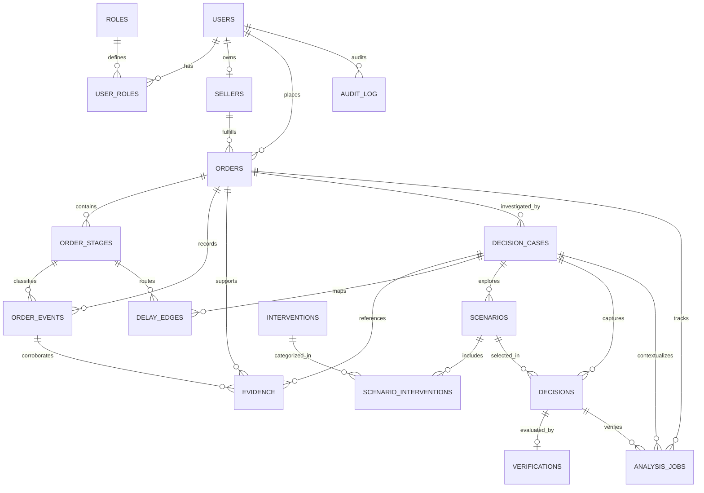

# 04. Database Design & Architecture

## 1. Multi-Tier Storage Strategy

Causara employs a polyglot persistence architecture on Microsoft Azure:

| Storage Service | Role in Architecture | Handled Entities & Data Assets |
|---|---|---|
| **Azure SQL Database** | Primary Transactional Source of Truth | 18 normalized tables: users, roles, orders, stages, events, cases, decisions, audit logs, outbox queue messages, and asynchronous job states. |
| **Azure Cosmos DB** | Semi-Structured Document Store | Rich JSON documents for complex intervention scenarios, model assumptions, graph structures, and analytical outputs. |
| **Azure Blob Storage** | Unstructured Object Store | Private binary attachments: photographic delivery proof, courier dispatch manifests, damaged packaging evidence, and raw payloads. |

### 1.1 SQL and Cosmos DB Consistency Workflow (Retryable Persistence)
Because Azure SQL Database and Azure Cosmos DB do not share a two-phase commit (2PC) distributed transaction boundary, Causara enforces a state-machine-driven, retryable persistence pattern with SQL as the transactional authority:

1. **SQL Pre-Registration**: When an analytical scenario is generated, the scenario summary is committed to Azure SQL (`scenarios`) with `status = 'PENDING_PERSISTENCE'` and a deterministic document identifier (`cosmos_document_id = 'case_{case_id}_scn_{scenario_id}'`).
2. **Cosmos DB Upsert**: The analytical worker executes an idempotent upsert of the complete scenario graph, Monte Carlo simulation arrays, and detailed assumption trees into Azure Cosmos DB using the deterministic document ID.
3. **SQL Status Finalization**: Upon receiving Cosmos DB HTTP 200/201 confirmation, the worker updates the scenario record in Azure SQL to `status = 'READY'`.
4. **Failure & Retry Protocol**: If the Cosmos DB write or network acknowledgment fails, the SQL scenario remains in `PENDING_PERSISTENCE`. The worker retries the operation idempotently using the identical document ID.
5. **Reconciliation & Orphan Cleanup**: A timer-triggered Azure Function scans for scenarios with `status = 'PENDING_PERSISTENCE'` older than 15 minutes to either retry the Cosmos write or mark the scenario `FAILED`. Cosmos documents that lack a corresponding `READY` scenario record in SQL after 24 hours are purged during scheduled maintenance.

---

## 2. Relational Schema Architecture (18 Tables)

### 2.1 Identity & Access Management (IAM)

#### 1. `users`
Stores user authentication identities across all roles.
```sql
CREATE TABLE users (
    user_id BIGINT IDENTITY(1,1) PRIMARY KEY,
    full_name NVARCHAR(100) NOT NULL,
    email NVARCHAR(254) NOT NULL UNIQUE,
    password_hash NVARCHAR(255) NOT NULL,
    is_active BIT NOT NULL DEFAULT 1,
    created_at DATETIME2 NOT NULL DEFAULT SYSUTCDATETIME()
);
```

#### 2. `roles`
Enumerates standardized system roles.
```sql
CREATE TABLE roles (
    role_id SMALLINT IDENTITY(1,1) PRIMARY KEY,
    role_name NVARCHAR(40) NOT NULL UNIQUE, -- 'CUSTOMER', 'SELLER', 'MANAGER', 'ANALYST', 'AUDITOR', 'ADMIN'
    description NVARCHAR(255) NULL
);
```

#### 3. `user_roles`
Junction table mapping users to one or more roles.
```sql
CREATE TABLE user_roles (
    user_id BIGINT NOT NULL,
    role_id SMALLINT NOT NULL,
    assigned_at DATETIME2 NOT NULL DEFAULT SYSUTCDATETIME(),
    assigned_by BIGINT NULL,
    CONSTRAINT PK_user_roles PRIMARY KEY (user_id, role_id),
    CONSTRAINT FK_user_roles_user FOREIGN KEY (user_id) REFERENCES users(user_id) ON DELETE CASCADE,
    CONSTRAINT FK_user_roles_role FOREIGN KEY (role_id) REFERENCES roles(role_id),
    CONSTRAINT FK_user_roles_assigned_by FOREIGN KEY (assigned_by) REFERENCES users(user_id)
);
```

#### 4. `sellers`
Encapsulates seller operational profiles and multi-tenant scoping.
```sql
CREATE TABLE sellers (
    seller_id BIGINT IDENTITY(1,1) PRIMARY KEY,
    owner_user_id BIGINT NOT NULL UNIQUE,
    business_name NVARCHAR(150) NOT NULL,
    contact_number NVARCHAR(20) NULL,
    business_status NVARCHAR(20) NOT NULL DEFAULT 'ACTIVE', -- 'ACTIVE', 'SUSPENDED', 'UNDER_REVIEW'
    created_at DATETIME2 NOT NULL DEFAULT SYSUTCDATETIME(),
    CONSTRAINT FK_sellers_owner FOREIGN KEY (owner_user_id) REFERENCES users(user_id)
);
```

---

### 2.2 Order Lifecycle & Event History

#### 5. `orders`
The central order entity representing a customer purchase fulfillment contract.
```sql
CREATE TABLE orders (
    order_id BIGINT IDENTITY(1,1) PRIMARY KEY,
    seller_id BIGINT NOT NULL,
    customer_user_id BIGINT NOT NULL,
    external_order_ref NVARCHAR(100) NOT NULL,
    placed_at DATETIME2 NOT NULL,
    expected_delivery_at DATETIME2 NOT NULL,
    actual_delivery_at DATETIME2 NULL,
    status NVARCHAR(30) NOT NULL DEFAULT 'PLACED', -- 'PLACED', 'PROCESSING', 'DISPATCHED', 'IN_TRANSIT', 'DELIVERED', 'DELAYED', 'CANCELLED'
    created_at DATETIME2 NOT NULL DEFAULT SYSUTCDATETIME(),
    CONSTRAINT FK_orders_seller FOREIGN KEY (seller_id) REFERENCES sellers(seller_id),
    CONSTRAINT FK_orders_customer FOREIGN KEY (customer_user_id) REFERENCES users(user_id),
    CONSTRAINT UQ_orders_seller_ref UNIQUE (seller_id, external_order_ref),
    CONSTRAINT CK_orders_delivery_window CHECK (expected_delivery_at > placed_at)
);
```

#### 6. `order_stages`
Represents the sequential planned and actual stages of an order lifecycle. Order ownership (`order_id`) is strictly immutable after record creation, enforced at the database level by trigger `trg_order_stages_immutable_order`.
```sql
CREATE TABLE order_stages (
    stage_id BIGINT IDENTITY(1,1) PRIMARY KEY,
    order_id BIGINT NOT NULL,
    stage_code NVARCHAR(40) NOT NULL, -- 'SELLER_PROCESSING', 'DISPATCH', 'LINEHAUL_TRANSPORT', 'LAST_MILE', 'DELIVERED'
    sequence_no INT NOT NULL,
    planned_start_at DATETIME2 NULL,
    planned_end_at DATETIME2 NULL,
    actual_start_at DATETIME2 NULL,
    actual_end_at DATETIME2 NULL,
    status NVARCHAR(25) NOT NULL DEFAULT 'PENDING', -- 'PENDING', 'IN_PROGRESS', 'COMPLETED', 'SKIPPED'
    CONSTRAINT FK_order_stages_order FOREIGN KEY (order_id) REFERENCES orders(order_id) ON DELETE CASCADE,
    CONSTRAINT UQ_order_stages_seq UNIQUE (order_id, sequence_no),
    CONSTRAINT UQ_order_stages_order_stage UNIQUE (order_id, stage_id)
);
```

#### 7. `order_events`
An immutable, append-only historical log of all operational events. Cross-order stage references are prevented via composite foreign key.
```sql
CREATE TABLE order_events (
    event_id BIGINT IDENTITY(1,1) PRIMARY KEY,
    order_id BIGINT NOT NULL,
    stage_id BIGINT NULL,
    event_type NVARCHAR(50) NOT NULL,
    occurred_at DATETIME2 NOT NULL,
    received_at DATETIME2 NOT NULL DEFAULT SYSUTCDATETIME(),
    source_type NVARCHAR(20) NOT NULL, -- 'MANUAL_DASHBOARD', 'COURIER_API', 'OMS_WEBHOOK', 'SYSTEM'
    source_provider NVARCHAR(100) NULL,
    source_event_id NVARCHAR(150) NULL,
    idempotency_key NVARCHAR(200) NOT NULL UNIQUE,
    location NVARCHAR(200) NULL,
    description NVARCHAR(500) NULL,
    raw_payload NVARCHAR(MAX) NULL,
    CONSTRAINT FK_order_events_order FOREIGN KEY (order_id) REFERENCES orders(order_id),
    CONSTRAINT FK_order_events_order_stage FOREIGN KEY (order_id, stage_id) REFERENCES order_stages(order_id, stage_id),
    CONSTRAINT UQ_order_events_order_event UNIQUE (order_id, event_id)
);
```
*(In SQL Server, if `stage_id` is NULL, `FK_order_events_order_stage` passes; if populated, it strictly guarantees that `stage_id` belongs to `order_id`.)*

---

### 2.3 Evidence & Investigation Cases

#### 8. `evidence`
Stores cryptographic references and lifecycle metadata for binary files hosted in Azure Blob Storage with composite order integrity.
```sql
CREATE TABLE evidence (
    evidence_id BIGINT IDENTITY(1,1) PRIMARY KEY,
    order_id BIGINT NOT NULL,
    event_id BIGINT NULL,
    case_id BIGINT NULL,
    uploaded_by BIGINT NOT NULL,
    blob_uri NVARCHAR(500) NOT NULL UNIQUE,
    file_name NVARCHAR(255) NOT NULL,
    content_type NVARCHAR(100) NOT NULL,
    sha256_hash CHAR(64) NOT NULL,
    status NVARCHAR(25) NOT NULL DEFAULT 'PENDING_UPLOAD',
    upload_expires_at DATETIME2 NOT NULL,
    completed_at DATETIME2 NULL,
    uploaded_at DATETIME2 NOT NULL DEFAULT SYSUTCDATETIME(),
    CONSTRAINT FK_evidence_order FOREIGN KEY (order_id) REFERENCES orders(order_id),
    CONSTRAINT FK_evidence_order_event FOREIGN KEY (order_id, event_id) REFERENCES order_events(order_id, event_id),
    CONSTRAINT FK_evidence_order_case FOREIGN KEY (order_id, case_id) REFERENCES decision_cases(order_id, case_id),
    CONSTRAINT FK_evidence_uploader FOREIGN KEY (uploaded_by) REFERENCES users(user_id),
    CONSTRAINT CK_evidence_status CHECK (status IN ('PENDING_UPLOAD', 'ACTIVE', 'FAILED', 'DELETED'))
);
```
> **Evidence Domain Rules**:
> - Evidence with status `PENDING_UPLOAD` or `FAILED` cannot be referenced as corroborating proof in delay reports, audit logs, or decision approvals.
> - The composite foreign keys strictly guarantee at the database level that any referenced `event_id` or `case_id` belongs to the exact same `order_id`.

#### 9. `decision_cases`
Represents an active or resolved delay investigation instance opened on an order. Order ownership (`order_id`) is strictly immutable after record creation, enforced at the database level by trigger `trg_decision_cases_immutable_order`.
```sql
CREATE TABLE decision_cases (
    case_id BIGINT IDENTITY(1,1) PRIMARY KEY,
    order_id BIGINT NOT NULL,
    created_by BIGINT NOT NULL,
    case_title NVARCHAR(150) NOT NULL,
    status NVARCHAR(25) NOT NULL DEFAULT 'OPEN', -- 'OPEN', 'ANALYZING', 'PENDING_APPROVAL', 'RESOLVED', 'CLOSED'
    opened_at DATETIME2 NOT NULL DEFAULT SYSUTCDATETIME(),
    closed_at DATETIME2 NULL,
    CONSTRAINT FK_decision_cases_order FOREIGN KEY (order_id) REFERENCES orders(order_id),
    CONSTRAINT FK_decision_cases_creator FOREIGN KEY (created_by) REFERENCES users(user_id),
    CONSTRAINT UQ_decision_cases_order_case UNIQUE (order_id, case_id)
);
```

#### 10. `delay_edges`
Models directional links in the delay reconstruction graph. Preserves strict 3NF without duplicating `order_id`; `case_id`, `from_stage_id`, and `to_stage_id` are strictly `NOT NULL`. Cross-order integrity, self-loop prevention, and parent order immutability are enforced by database triggers (`trg_delay_edges_order_stage_integrity`, `trg_decision_cases_immutable_order`, `trg_order_stages_immutable_order`).
```sql
CREATE TABLE delay_edges (
    edge_id BIGINT IDENTITY(1,1) PRIMARY KEY,
    case_id BIGINT NOT NULL,
    from_stage_id BIGINT NOT NULL,
    to_stage_id BIGINT NOT NULL,
    edge_type NVARCHAR(30) NOT NULL, -- 'STAGE_TRANSITION', 'BOTTLENECK_PROPAGATION', 'CORRELATION'
    evidence_class NVARCHAR(20) NOT NULL, -- 'FACT', 'HYPOTHESIS', 'ESTIMATE'
    estimated_delay_minutes BIGINT NULL,
    explanation NVARCHAR(1000) NULL,
    CONSTRAINT FK_delay_edges_case FOREIGN KEY (case_id) REFERENCES decision_cases(case_id) ON DELETE CASCADE,
    CONSTRAINT FK_delay_edges_from FOREIGN KEY (from_stage_id) REFERENCES order_stages(stage_id),
    CONSTRAINT FK_delay_edges_to FOREIGN KEY (to_stage_id) REFERENCES order_stages(stage_id)
);
```

---

### 2.4 Interventions & Scenario Analysis

#### 11. `interventions`
Catalog of operational actions available to remediate delays.
```sql
CREATE TABLE interventions (
    intervention_id BIGINT IDENTITY(1,1) PRIMARY KEY,
    intervention_code NVARCHAR(50) NOT NULL UNIQUE, -- 'PRIORITY_PACKING', 'CARRIER_REROUTE', 'AIR_FREIGHT_UPGRADE'
    name NVARCHAR(150) NOT NULL,
    description NVARCHAR(500) NULL,
    intervention_type NVARCHAR(50) NOT NULL, -- 'WAREHOUSE', 'CARRIER', 'NOTIFICATION', 'COMMUNICATION'
    is_active BIT NOT NULL DEFAULT 1
);
```

#### 12. `scenarios`
Simulated counterfactual packages consisting of one or more interventions.
```sql
CREATE TABLE scenarios (
    scenario_id BIGINT IDENTITY(1,1) PRIMARY KEY,
    case_id BIGINT NOT NULL,
    scenario_name NVARCHAR(150) NOT NULL,
    status NVARCHAR(25) NOT NULL DEFAULT 'PENDING_PERSISTENCE',
    predicted_time_saved_minutes BIGINT NULL,
    estimated_cost DECIMAL(12,2) NULL,
    risk_level NVARCHAR(20) NOT NULL, -- 'LOW', 'MEDIUM', 'HIGH'
    confidence_score DECIMAL(5,4) NULL,
    cosmos_document_id NVARCHAR(150) NULL,
    model_version NVARCHAR(50) NULL,
    created_at DATETIME2 NOT NULL DEFAULT SYSUTCDATETIME(),
    CONSTRAINT FK_scenarios_case FOREIGN KEY (case_id) REFERENCES decision_cases(case_id) ON DELETE CASCADE,
    CONSTRAINT UQ_scenarios_case_scenario UNIQUE (case_id, scenario_id),
    CONSTRAINT CK_scenarios_status CHECK (status IN ('PENDING_PERSISTENCE', 'READY', 'FAILED')),
    CONSTRAINT CK_scenarios_confidence CHECK (confidence_score BETWEEN 0.0 AND 1.0),
    CONSTRAINT CK_scenarios_cost CHECK (estimated_cost >= 0.0)
);
```

#### 13. `scenario_interventions`
Many-to-many junction table assigning catalog interventions to specific scenarios.
```sql
CREATE TABLE scenario_interventions (
    scenario_id BIGINT NOT NULL,
    intervention_id BIGINT NOT NULL,
    estimated_cost_contribution DECIMAL(12,2) NULL,
    CONSTRAINT PK_scenario_interventions PRIMARY KEY (scenario_id, intervention_id),
    CONSTRAINT FK_scenario_interventions_scenario FOREIGN KEY (scenario_id) REFERENCES scenarios(scenario_id) ON DELETE CASCADE,
    CONSTRAINT FK_scenario_interventions_intervention FOREIGN KEY (intervention_id) REFERENCES interventions(intervention_id)
);
```

---

### 2.5 Decisions & Verification

#### 14. `decisions`
Stores recorded seller intervention choices and manager approval records with composite case-scenario integrity.
```sql
CREATE TABLE decisions (
    decision_id BIGINT IDENTITY(1,1) PRIMARY KEY,
    case_id BIGINT NOT NULL,
    scenario_id BIGINT NOT NULL,
    decided_by BIGINT NOT NULL,
    approved_by BIGINT NULL,
    decision_status NVARCHAR(25) NOT NULL DEFAULT 'PENDING', -- 'PENDING', 'APPROVED', 'REJECTED', 'EXECUTED'
    rationale NVARCHAR(1000) NULL,
    selected_at DATETIME2 NOT NULL DEFAULT SYSUTCDATETIME(),
    approved_at DATETIME2 NULL,
    CONSTRAINT FK_decisions_case FOREIGN KEY (case_id) REFERENCES decision_cases(case_id),
    CONSTRAINT FK_decisions_case_scenario FOREIGN KEY (case_id, scenario_id) REFERENCES scenarios(case_id, scenario_id),
    CONSTRAINT FK_decisions_decider FOREIGN KEY (decided_by) REFERENCES users(user_id),
    CONSTRAINT FK_decisions_approver FOREIGN KEY (approved_by) REFERENCES users(user_id),
    CONSTRAINT UQ_decisions_case_decision UNIQUE (case_id, decision_id)
);
```

#### 15. `verifications`
Empirical observation comparisons benchmarked against predicted intervention metrics. Forecast errors are strictly derived as SQL computed columns to maintain third normal form (3NF). Cardinality is strictly 1:0..1 per decision for MVP.
```sql
CREATE TABLE verifications (
    verification_id BIGINT IDENTITY(1,1) PRIMARY KEY,
    decision_id BIGINT NOT NULL,
    measured_at DATETIME2 NOT NULL DEFAULT SYSUTCDATETIME(),
    original_expected_delivery_at DATETIME2 NOT NULL,
    baseline_estimated_delivery_at DATETIME2 NULL,
    predicted_delivery_at DATETIME2 NOT NULL,
    actual_delivery_at DATETIME2 NOT NULL,
    signed_prediction_error_minutes AS (DATEDIFF(MINUTE, predicted_delivery_at, actual_delivery_at)) PERSISTED,
    absolute_prediction_error_minutes AS (ABS(DATEDIFF(MINUTE, predicted_delivery_at, actual_delivery_at))) PERSISTED,
    delivery_variance_minutes AS (DATEDIFF(MINUTE, original_expected_delivery_at, actual_delivery_at)) PERSISTED,
    outcome_notes NVARCHAR(1000) NULL,
    CONSTRAINT FK_verifications_decision FOREIGN KEY (decision_id) REFERENCES decisions(decision_id),
    CONSTRAINT UQ_verifications_decision UNIQUE (decision_id)
);
```

> **Epistemological Distinction: Forecast Error vs. Causal Effect**:
> - `signed_prediction_error_minutes`: Forecast accuracy ($T_{actual} - T_{predicted}$). A positive number indicates the package arrived later than the intervention model forecast; a negative number indicates it arrived earlier.
> - `delivery_variance_minutes`: Net customer deviation ($T_{actual} - T_{expected}$).
> - **Causal Integrity Rule**: The observed difference between a hypothetical baseline estimate and actual delivery ($T_{baseline} - T_{actual}$) represents an *estimated counterfactual recovery*, not experimentally proven causal impact, because the system cannot observe what would have occurred had the intervention not been deployed. Repeated verification processing reconciles the single verified record rather than creating duplicates.

---

### 2.6 Auditing & Reliability Infrastructure

#### 16. `audit_log`
Immutable record of all business mutations and security operations.
```sql
CREATE TABLE audit_log (
    audit_id BIGINT IDENTITY(1,1) PRIMARY KEY,
    actor_user_id BIGINT NULL,
    action NVARCHAR(100) NOT NULL,
    entity_type NVARCHAR(50) NOT NULL,
    entity_id BIGINT NOT NULL,
    occurred_at DATETIME2 NOT NULL DEFAULT SYSUTCDATETIME(),
    metadata_json NVARCHAR(MAX) NULL,
    CONSTRAINT FK_audit_log_user FOREIGN KEY (actor_user_id) REFERENCES users(user_id)
);
```

#### 17. `outbox_events`
Implements the Transactional Outbox Pattern to guarantee message dispatch to Azure Storage Queues.
```sql
CREATE TABLE outbox_events (
    outbox_id BIGINT IDENTITY(1,1) PRIMARY KEY,
    event_type NVARCHAR(100) NOT NULL,
    aggregate_type NVARCHAR(50) NOT NULL,
    aggregate_id BIGINT NOT NULL,
    payload_json NVARCHAR(MAX) NOT NULL,
    status NVARCHAR(20) NOT NULL DEFAULT 'PENDING', -- 'PENDING', 'PROCESSING', 'PUBLISHED', 'FAILED'
    retry_count INT NOT NULL DEFAULT 0,
    created_at DATETIME2 NOT NULL DEFAULT SYSUTCDATETIME(),
    published_at DATETIME2 NULL
);
```

#### 18. `analysis_jobs`
Tracks asynchronous execution lifecycle, retries, and worker outcomes. Timeline reconstruction can execute for an order before any investigation case exists. Composite constraints prevent order/case/decision misalignment, and `CK_analysis_jobs_type_deps` enforces state consistency.
```sql
CREATE TABLE analysis_jobs (
    job_id BIGINT IDENTITY(1,1) PRIMARY KEY,
    order_id BIGINT NOT NULL,
    case_id BIGINT NULL,
    decision_id BIGINT NULL,
    job_type NVARCHAR(50) NOT NULL, -- 'TIMELINE_RECONSTRUCTION', 'SCENARIO_SIMULATION', 'OUTCOME_VERIFICATION'
    status NVARCHAR(20) NOT NULL DEFAULT 'QUEUED', -- 'QUEUED', 'RUNNING', 'COMPLETED', 'FAILED'
    idempotency_key NVARCHAR(200) NOT NULL UNIQUE,
    retry_count INT NOT NULL DEFAULT 0,
    created_at DATETIME2 NOT NULL DEFAULT SYSUTCDATETIME(),
    started_at DATETIME2 NULL,
    completed_at DATETIME2 NULL,
    error_message NVARCHAR(1000) NULL,
    CONSTRAINT FK_analysis_jobs_order FOREIGN KEY (order_id) REFERENCES orders(order_id),
    CONSTRAINT FK_analysis_jobs_order_case FOREIGN KEY (order_id, case_id) REFERENCES decision_cases(order_id, case_id),
    CONSTRAINT FK_analysis_jobs_case_decision FOREIGN KEY (case_id, decision_id) REFERENCES decisions(case_id, decision_id),
    CONSTRAINT CK_analysis_jobs_status CHECK (status IN ('QUEUED', 'RUNNING', 'COMPLETED', 'FAILED')),
    CONSTRAINT CK_analysis_jobs_type_deps CHECK (
        (job_type = 'TIMELINE_RECONSTRUCTION' AND case_id IS NULL AND decision_id IS NULL) OR
        (job_type = 'SCENARIO_SIMULATION' AND case_id IS NOT NULL AND decision_id IS NULL) OR
        (job_type = 'OUTCOME_VERIFICATION' AND case_id IS NOT NULL AND decision_id IS NOT NULL)
    )
);
```

> **Relationship between `outbox_events` and `analysis_jobs`**:
> - `analysis_jobs` tracks domain job state, execution progress, and worker outcomes.
> - `outbox_events` provides atomic transactional publishing into Azure Storage Queue.
> - When an API or ingestion event creates an analysis job, both the `analysis_jobs` row and a corresponding `outbox_events` row (with payload containing `{"job_id": job_id, "order_id": order_id}`) are committed in the same SQL transaction. The Timer-Triggered Outbox Dispatcher pushes the `job_id` into the Azure Storage Queue.

---

## 3. Entity Relationship Diagram (ERD)


*Note: `outbox_events` operates as a generic message outbox decoupled from specific entity foreign keys to support polymorphic dispatch.*

---

## 4. Normalization Analysis (1NF, 2NF, 3NF)

### 4.1 First Normal Form (1NF)
- **Atomic Values**: Every cell contains a single scalar value. Event logs, role mappings, and scenario items are partitioned into dedicated relation tables.
- **Unique Identification**: Every table defines an explicit primary key (`BIGINT IDENTITY` or composite primary key).

### 4.2 Second Normal Form (2NF)
- **Full Functional Dependency**: No non-prime attribute depends on a proper subset of any composite candidate key.
- **Proof (`scenario_interventions`)**:
  - Composite Key: `(scenario_id, intervention_id)`
  - Non-key Attribute: `estimated_cost_contribution`
  - Cost contribution depends strictly on the combined pairing of that specific intervention executed within that specific scenario context.
- **Proof (`user_roles`)**:
  - Composite Key: `(user_id, role_id)`
  - Attributes `assigned_at` and `assigned_by` depend strictly on the complete user-role assignment.

### 4.3 Third Normal Form (3NF)
- **Elimination of Transitive Dependencies**: Non-key attributes depend solely on candidate keys ($X \to Y$ where $X$ is a superkey).
- **Proof (`delay_edges` Strict 3NF Preservation)**:
  - `case_id` functionally determines `order_id` via `decision_cases`. Retaining `delay_edges` without an `order_id` column prevents transitive redundancy, with order-stage integrity strictly enforced via database trigger `trg_delay_edges_order_stage_integrity`.
- **Proof (`verifications` Computed Columns)**:
  - Rather than storing `signed_prediction_error_minutes` or `absolute_prediction_error_minutes` as independently editable columns, they are derived as SQL Server `PERSISTED` computed columns from `predicted_delivery_at` and `actual_delivery_at`, eliminating redundant non-key dependencies and preventing data drift.

---

## 5. Performance Indexing Strategy

```sql
-- Login & User Lookup
CREATE NONCLUSTERED INDEX IX_users_email ON users(email);

-- Seller & Customer Order Filtering
CREATE NONCLUSTERED INDEX IX_orders_seller_placed ON orders(seller_id, placed_at DESC);
CREATE NONCLUSTERED INDEX IX_orders_customer ON orders(customer_user_id, placed_at DESC);

-- Chronological Event Timeline Traversal
CREATE NONCLUSTERED INDEX IX_order_events_timeline ON order_events(order_id, occurred_at ASC);

-- Stage Sorting & Reconstruction
CREATE NONCLUSTERED INDEX IX_order_stages_seq ON order_stages(order_id, sequence_no ASC);

-- Active Investigation Lookup
CREATE NONCLUSTERED INDEX IX_decision_cases_order_status ON decision_cases(order_id, status);

-- Composite Scenario Retrieval & Validation
CREATE NONCLUSTERED INDEX IX_scenarios_case ON scenarios(case_id, scenario_id);

-- Asynchronous Outbox Worker Polling
CREATE NONCLUSTERED INDEX IX_outbox_events_pending ON outbox_events(status, created_at ASC)
WHERE status IN ('PENDING', 'PROCESSING');

-- Asynchronous Job Execution Polling & Lookup
CREATE NONCLUSTERED INDEX IX_analysis_jobs_order_status ON analysis_jobs(order_id, status);
CREATE NONCLUSTERED INDEX IX_analysis_jobs_case ON analysis_jobs(case_id) WHERE case_id IS NOT NULL;
CREATE NONCLUSTERED INDEX IX_analysis_jobs_decision ON analysis_jobs(decision_id) WHERE decision_id IS NOT NULL;

-- Audit Log Time-Series Queries
CREATE NONCLUSTERED INDEX IX_audit_log_entity_time ON audit_log(entity_type, entity_id, occurred_at DESC);
```

---

## 6. Required SQL Objects (Views, Stored Procedures, Triggers, Transactions)

### 6.1 Analytical SQL Views

#### `vw_SellerDelaySummary`
Aggregates seller delay metrics for the Operations Portal.
```sql
CREATE OR ALTER VIEW vw_SellerDelaySummary AS
SELECT 
    s.seller_id,
    s.business_name,
    COUNT(o.order_id) AS total_orders,
    SUM(CASE WHEN o.status = 'DELAYED' THEN 1 ELSE 0 END) AS delayed_orders,
    CAST(AVG(DATEDIFF(MINUTE, o.placed_at, ISNULL(o.actual_delivery_at, SYSUTCDATETIME()))) / 60.0 AS DECIMAL(10,2)) AS avg_fulfillment_hours,
    CAST(AVG(CASE WHEN o.actual_delivery_at > o.expected_delivery_at 
                  THEN DATEDIFF(MINUTE, o.expected_delivery_at, o.actual_delivery_at) 
                  ELSE 0 END) / 60.0 AS DECIMAL(10,2)) AS avg_excess_delay_hours
FROM sellers s
LEFT JOIN orders o ON s.seller_id = o.seller_id
GROUP BY s.seller_id, s.business_name;
```

#### `vw_OrderStageDelayBreakdown`
Computes planned versus actual stage durations.
```sql
CREATE OR ALTER VIEW vw_OrderStageDelayBreakdown AS
SELECT 
    os.order_id,
    os.stage_id,
    os.stage_code,
    os.sequence_no,
    DATEDIFF(MINUTE, os.planned_start_at, os.planned_end_at) AS planned_duration_minutes,
    DATEDIFF(MINUTE, os.actual_start_at, os.actual_end_at) AS actual_duration_minutes,
    (DATEDIFF(MINUTE, os.actual_start_at, os.actual_end_at) - 
     DATEDIFF(MINUTE, os.planned_start_at, os.planned_end_at)) AS variance_minutes
FROM order_stages os
WHERE os.actual_start_at IS NOT NULL AND os.actual_end_at IS NOT NULL;
```

### 6.2 Database Integrity Triggers

Causara employs multi-row safe database triggers to enforce relational constraints that cannot be expressed purely via static declarative foreign keys while maintaining strict Third Normal Form (3NF).

#### `trg_delay_edges_order_stage_integrity`
Enforces cross-order integrity and self-loop prevention on `delay_edges` without introducing redundant `order_id` columns, preserving strict 3NF. Safely evaluates multi-row `INSERT` and `UPDATE` operations:
```sql
CREATE OR ALTER TRIGGER trg_delay_edges_order_stage_integrity
ON delay_edges
AFTER INSERT, UPDATE
AS
BEGIN
    SET NOCOUNT ON;

    -- 1. Disallow self-loops (from_stage_id == to_stage_id)
    IF EXISTS (
        SELECT 1 
        FROM inserted 
        WHERE from_stage_id = to_stage_id
    )
    BEGIN
        THROW 50010, 'Invalid delay edge: from_stage_id and to_stage_id cannot be identical.', 1;
    END;

    -- 2. Verify case, from_stage, and to_stage all belong to the identical order_id (multi-row safe)
    IF EXISTS (
        SELECT 1
        FROM inserted i
        JOIN decision_cases dc ON i.case_id = dc.case_id
        JOIN order_stages fs ON i.from_stage_id = fs.stage_id
        JOIN order_stages ts ON i.to_stage_id = ts.stage_id
        WHERE dc.order_id <> fs.order_id 
           OR dc.order_id <> ts.order_id
    )
    BEGIN
        THROW 50011, 'Cross-order integrity violation: delay edge stages must belong to the exact order investigated by the decision case.', 1;
    END;
END;
```

#### `trg_order_stages_immutable_order`
Guarantees parent-record immutability on `order_stages`. An order stage is permanently bound to its parent order upon creation; updating `order_id` is prohibited to prevent invalidating referencing child records (including `order_events` and `delay_edges`). Evaluates multi-row updates safely:
```sql
CREATE OR ALTER TRIGGER trg_order_stages_immutable_order
ON order_stages
AFTER UPDATE
AS
BEGIN
    SET NOCOUNT ON;

    IF UPDATE(order_id)
    BEGIN
        IF EXISTS (
            SELECT 1 
            FROM inserted i 
            JOIN deleted d ON i.stage_id = d.stage_id 
            WHERE i.order_id <> d.order_id
        )
        BEGIN
            THROW 50012, 'Order ownership immutability violation: order_stages.order_id cannot be modified after record creation.', 1;
        END;
    END;
END;
```

#### `trg_decision_cases_immutable_order`
Guarantees parent-record immutability on `decision_cases`. An investigation case is permanently bound to its parent order upon creation; updating `order_id` is prohibited to prevent invalidating referencing child records (including `delay_edges`, `scenarios`, `decisions`, and `analysis_jobs`). Evaluates multi-row updates safely:
```sql
CREATE OR ALTER TRIGGER trg_decision_cases_immutable_order
ON decision_cases
AFTER UPDATE
AS
BEGIN
    SET NOCOUNT ON;

    IF UPDATE(order_id)
    BEGIN
        IF EXISTS (
            SELECT 1 
            FROM inserted i 
            JOIN deleted d ON i.case_id = d.case_id 
            WHERE i.order_id <> d.order_id
        )
        BEGIN
            THROW 50013, 'Order ownership immutability violation: decision_cases.order_id cannot be modified after record creation.', 1;
        END;
    END;
END;
```

### 6.3 Stored Procedures

#### `usp_CreateDecisionCase`
Atomically provisions a delay investigation, enqueues an asynchronous analysis job, and registers an outbox event.
```sql
CREATE OR ALTER PROCEDURE usp_CreateDecisionCase
    @OrderId BIGINT,
    @CreatedBy BIGINT,
    @CaseTitle NVARCHAR(150),
    @NewCaseId BIGINT OUTPUT
AS
BEGIN
    SET NOCOUNT ON;
    BEGIN TRY
        BEGIN TRANSACTION;

        IF NOT EXISTS (SELECT 1 FROM orders WHERE order_id = @OrderId)
            THROW 50001, 'Invalid order_id specified.', 1;

        INSERT INTO decision_cases (order_id, created_by, case_title, status, opened_at)
        VALUES (@OrderId, @CreatedBy, @CaseTitle, 'OPEN', SYSUTCDATETIME());

        SET @NewCaseId = SCOPE_IDENTITY();

        -- Create tracked asynchronous job record
        DECLARE @JobId BIGINT;
        DECLARE @JobIdempotencyKey NVARCHAR(200) = CONCAT('case-init-', @NewCaseId, '-', CONVERT(NVARCHAR(36), NEWID()));

        INSERT INTO analysis_jobs (
            order_id, case_id, decision_id, job_type, status, idempotency_key, retry_count, created_at
        )
        VALUES (
            @OrderId, @NewCaseId, NULL, 'SCENARIO_SIMULATION', 'QUEUED', @JobIdempotencyKey, 0, SYSUTCDATETIME()
        );

        SET @JobId = SCOPE_IDENTITY();

        -- Insert outbox event for the Timer-Triggered Dispatcher
        INSERT INTO outbox_events (event_type, aggregate_type, aggregate_id, payload_json)
        VALUES (
            'ANALYSIS_JOB_QUEUED', 
            'ANALYSIS_JOB', 
            @JobId, 
            JSON_OBJECT('job_id': @JobId, 'order_id': @OrderId, 'case_id': @NewCaseId, 'job_type': 'SCENARIO_SIMULATION')
        );

        INSERT INTO audit_log (actor_user_id, action, entity_type, entity_id, occurred_at)
        VALUES (@CreatedBy, 'CASE_OPENED', 'DECISION_CASE', @NewCaseId, SYSUTCDATETIME());

        COMMIT TRANSACTION;
    END TRY
    BEGIN CATCH
        IF @@TRANCOUNT > 0 ROLLBACK TRANSACTION;
        THROW;
    END CATCH
END;
```

#### `usp_VerifyPrediction`
Records actual delivery observations against predicted intervention metrics. Forecast errors and variances are automatically derived by SQL computed columns, maintaining 1:0..1 cardinality per decision via upsert/reconciliation.
```sql
CREATE OR ALTER PROCEDURE usp_VerifyPrediction
    @DecisionId BIGINT,
    @ActualDeliveryAt DATETIME2,
    @OutcomeNotes NVARCHAR(1000)
AS
BEGIN
    SET NOCOUNT ON;
    BEGIN TRY
        BEGIN TRANSACTION;

        DECLARE @CaseId BIGINT, @ScenarioId BIGINT, @PredictedMinutes BIGINT, @OriginalExpectedAt DATETIME2;

        SELECT 
            @CaseId = d.case_id,
            @ScenarioId = d.scenario_id,
            @PredictedMinutes = s.predicted_time_saved_minutes,
            @OriginalExpectedAt = o.expected_delivery_at
        FROM decisions d
        JOIN scenarios s ON d.scenario_id = s.scenario_id AND d.case_id = s.case_id
        JOIN decision_cases dc ON d.case_id = dc.case_id
        JOIN orders o ON dc.order_id = o.order_id
        WHERE d.decision_id = @DecisionId;

        IF @CaseId IS NULL
            THROW 50002, 'Decision record not found or inconsistent with case.', 1;

        -- Calculate predicted delivery timestamp based on predicted minutes saved
        DECLARE @PredictedDeliveryAt DATETIME2 = DATEADD(MINUTE, -@PredictedMinutes, @OriginalExpectedAt);

        -- Reconcile or Insert single verification record
        IF EXISTS (SELECT 1 FROM verifications WHERE decision_id = @DecisionId)
        BEGIN
            UPDATE verifications
            SET 
                measured_at = SYSUTCDATETIME(),
                original_expected_delivery_at = @OriginalExpectedAt,
                baseline_estimated_delivery_at = @OriginalExpectedAt,
                predicted_delivery_at = @PredictedDeliveryAt,
                actual_delivery_at = @ActualDeliveryAt,
                outcome_notes = @OutcomeNotes
            WHERE decision_id = @DecisionId;
        END
        ELSE
        BEGIN
            INSERT INTO verifications (
                decision_id, measured_at, original_expected_delivery_at,
                baseline_estimated_delivery_at, predicted_delivery_at,
                actual_delivery_at, outcome_notes
            )
            VALUES (
                @DecisionId, SYSUTCDATETIME(), @OriginalExpectedAt,
                @OriginalExpectedAt, @PredictedDeliveryAt,
                @ActualDeliveryAt, @OutcomeNotes
            );
        END;

        UPDATE decisions SET decision_status = 'VERIFIED' WHERE decision_id = @DecisionId;

        INSERT INTO audit_log (actor_user_id, action, entity_type, entity_id, occurred_at)
        VALUES (NULL, 'PREDICTION_VERIFIED', 'DECISION', @DecisionId, SYSUTCDATETIME());

        COMMIT TRANSACTION;
    END TRY
    BEGIN CATCH
        IF @@TRANCOUNT > 0 ROLLBACK TRANSACTION;
        THROW;
    END CATCH
END;
```

### 6.4 Transactional Approval Workflow
Ensures strict atomicity and case-scenario referential consistency when an Operations Manager approves an intervention decision.
```sql
BEGIN TRY
    BEGIN TRANSACTION;

    UPDATE decisions
    SET 
        decision_status = 'APPROVED',
        approved_by = @ManagerUserId,
        approved_at = SYSUTCDATETIME()
    WHERE decision_id = @DecisionId
      AND decision_status = 'PENDING';

    IF @@ROWCOUNT <> 1
        THROW 50003, 'Decision not in PENDING state or does not exist.', 1;

    INSERT INTO audit_log (actor_user_id, action, entity_type, entity_id, occurred_at)
    VALUES (@ManagerUserId, 'DECISION_APPROVED', 'DECISION', @DecisionId, SYSUTCDATETIME());

    INSERT INTO outbox_events (event_type, aggregate_type, aggregate_id, payload_json)
    VALUES (
        'DECISION_APPROVED',
        'DECISION',
        @DecisionId,
        JSON_OBJECT('decision_id': @DecisionId, 'approved_by': @ManagerUserId)
    );

    COMMIT TRANSACTION;
END TRY
BEGIN CATCH
    IF @@TRANCOUNT > 0 ROLLBACK TRANSACTION;
    THROW;
END CATCH;
```
