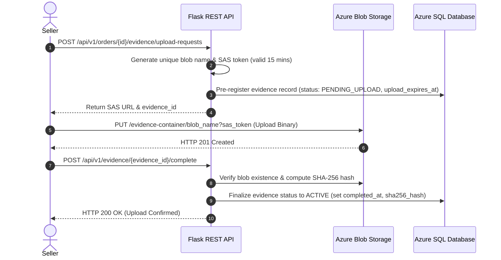

# 05. API Specification

## 1. API Architecture & Standards

- **Protocol**: HTTPS / REST
- **Base URL**: `/api/v1` (Local: `http://localhost:5000/api/v1`)
- **Format**: JSON (`Content-Type: application/json`)
- **Authentication**: JWT Bearer Tokens (`Authorization: Bearer <access_token>`)
- **Access Control**: Role-Based Access Control (RBAC) + Strict Resource Ownership Validation
- **Idempotency**: Supported via `Idempotency-Key` HTTP header for state-mutating requests

---

## 2. Standard Envelope Formats

### 2.1 Success Envelope
```json
{
  "success": true,
  "data": {
    "order_id": 101,
    "status": "DELAYED"
  },
  "meta": {
    "request_id": "req_88f912a",
    "timestamp": "2026-11-05T12:00:00Z"
  }
}
```

### 2.2 Error Envelope
```json
{
  "success": false,
  "error": {
    "code": "ORDER_NOT_FOUND",
    "message": "The requested order does not exist or access is unauthorized.",
    "details": null
  },
  "meta": {
    "request_id": "req_88f912b",
    "timestamp": "2026-11-05T12:00:01Z"
  }
}
```

---

## 3. Complete Endpoint Catalogue

### 3.1 Authentication & Session (`/auth`)

| Method | Endpoint | Description | Access |
|---|---|---|---|
| `POST` | `/auth/register` | Register a new customer user account | Public |
| `POST` | `/auth/login` | Authenticate credentials; return JWT access & refresh tokens | Public |
| `POST` | `/auth/refresh` | Renew access token using valid refresh token | Authenticated |
| `POST` | `/auth/logout` | Invalidate current refresh token | Authenticated |
| `GET` | `/auth/me` | Fetch active user profile and assigned roles | Authenticated |

#### `POST /auth/login` Request & Response
```json
// Request
{
  "email": "seller@demo.com",
  "password": "Password123!"
}

// Response (200 OK)
{
  "success": true,
  "data": {
    "access_token": "eyJhbGciOi...",
    "refresh_token": "d8a1e2f...",
    "expires_in_seconds": 900,
    "user": {
      "user_id": 20,
      "email": "seller@demo.com",
      "roles": ["SELLER"],
      "seller_id": 5
    }
  }
}
```

---

### 3.2 Order Management (`/orders`)

| Method | Endpoint | Description | Allowed Roles |
|---|---|---|---|
| `POST` | `/orders` | Create a new order with planned stages | Seller |
| `GET` | `/orders` | Paginated list of orders (tenant-scoped) | Customer, Seller, Manager |
| `GET` | `/orders/{id}` | Retrieve order details | Authorized Owner |
| `PATCH` | `/orders/{id}` | Update order attributes (e.g., expected delivery) | Seller, Manager |
| `GET` | `/orders/{id}/timeline` | Retrieve chronological normalized events & customer summary | Customer, Seller, Manager |
| `POST` | `/orders/{id}/timeline/reconstruct` | Trigger sync or async factual timeline reconstruction | Seller, Manager |
| `GET` | `/orders/{id}/stages` | Retrieve planned vs. actual stage records | Seller, Manager |
| `GET` | `/orders/stats` | Retrieve aggregated operational fulfillment metrics | All |
| `GET` | `/sellers` | Retrieve list of registered sellers | All |

#### `GET /orders/{id}/timeline` Response Contract
```json
// GET /api/v1/orders/101/timeline
{
  "success": true,
  "data": {
    "order_id": 101,
    "status": "DELAYED",
    "customer_summary": "Your package is currently in transit. A 24-hour delay occurred during warehouse fulfillment, but linehaul transport is running on schedule.",
    "timeline": [
      {
        "event_id": 5001,
        "event_type": "ORDER_PLACED",
        "stage_code": "SELLER_PROCESSING",
        "occurred_at": "2026-11-01T10:00:00Z",
        "location": "Online Store",
        "description": "Customer order confirmed."
      },
      {
        "event_id": 5002,
        "event_type": "DISPATCHED",
        "stage_code": "LINEHAUL_TRANSPORT",
        "occurred_at": "2026-11-03T10:00:00Z",
        "location": "Warehouse Hub 1, Bengaluru",
        "description": "Package handed over to BlueDart courier."
      }
    ]
  },
  "meta": {
    "request_id": "req_88f912c",
    "timestamp": "2026-11-05T12:00:00Z"
  }
}
```
> **Customer Summary Boundary**:
> - `customer_summary` provides a high-level, plain-language narrative tailored specifically for the customer.
> - It is `null` if delay analysis or explanation generation is still in progress.
> - It strictly omits sensitive internal hypotheses, specific supplier fault attribution, carrier dispute details, or internal financial figures.

---

### 3.3 Event Ingestion (`/orders/{id}/events` & `/webhooks`)

| Method | Endpoint | Description | Auth / Security |
|---|---|---|---|
| `POST` | `/orders/{id}/events` | Manually record an event via Seller Dashboard | JWT (Seller) + Idempotency-Key |
| `GET` | `/orders/{id}/events` | List raw event entries for an order | Authorized Owner |
| `POST` | `/webhooks/couriers/{provider}` | Ingest courier webhook updates | Provider HMAC Signature |
| `POST` | `/integrations/events/import` | Batch event ingestion for historical simulation | Manager, Admin |

#### `POST /orders/{id}/events` Request & Response
```json
// Request: POST /api/v1/orders/101/events
// Header: Idempotency-Key: manual-evt-101-dispatch-01
{
  "event_type": "DISPATCHED",
  "stage_code": "LINEHAUL_TRANSPORT",
  "occurred_at": "2026-11-04T10:30:00Z",
  "location": "Warehouse Hub 1, Bengaluru",
  "description": "Package handed over to BlueDart courier."
}

// Response (201 Created)
{
  "success": true,
  "data": {
    "event_id": 5001,
    "order_id": 101,
    "status": "ACCEPTED",
    "analysis_status": "QUEUED"
  }
}
```

---

### 3.4 Delay Analysis & Investigations (`/cases` & `/analysis`)

| Method | Endpoint | Description | Allowed Roles |
|---|---|---|---|
| `POST` | `/orders/{id}/cases` | Open a delay investigation case | Seller, Manager |
| `GET` | `/cases/{id}` | Fetch investigation details | Authorized Owner |
| `GET` | `/cases/{id}/delay-report` | Retrieve completed delay reconstruction | Seller, Manager, Analyst |
| `GET` | `/cases/{id}/delay-graph` | Fetch graph edges with epistemological tags | Seller, Manager, Analyst |
| `POST` | `/cases/{id}/analysis-jobs` | Trigger asynchronous re-analysis | Seller, Manager |
| `GET` | `/analysis-jobs/{id}` | Check status of background analysis job | Authorized Owner |
| `GET` | `/orders/{id}/analysis-jobs` | List analysis jobs for an order | Authorized Owner |

#### `GET /analysis-jobs/{id}` Response
```json
{
  "success": true,
  "data": {
    "job_id": 1201,
    "order_id": 101,
    "case_id": 9001,
    "decision_id": null,
    "job_type": "SCENARIO_SIMULATION",
    "status": "COMPLETED",
    "retry_count": 0,
    "created_at": "2026-11-05T12:00:00Z",
    "started_at": "2026-11-05T12:00:02Z",
    "completed_at": "2026-11-05T12:00:10Z",
    "error_message": null
  }
}
```

---

### 3.5 Interventions & Scenarios (`/cases/{id}/scenarios`)

| Method | Endpoint | Description | Allowed Roles |
|---|---|---|---|
| `GET` | `/cases/{id}/interventions` | List candidate remediation interventions | Seller, Manager |
| `POST` | `/cases/{id}/scenarios/generate` | Generate counterfactual scenario options | Seller, Manager |
| `GET` | `/cases/{id}/scenarios` | List simulated scenarios for an investigation | Seller, Manager, Analyst |
| `GET` | `/scenarios/{id}` | Retrieve scenario details and assumptions | Authorized Owner |

#### `GET /scenarios/{id}` Response
```json
{
  "success": true,
  "data": {
    "scenario_id": 3001,
    "case_id": 9001,
    "scenario_name": "Alternative Priority Linehaul",
    "status": "READY",
    "predicted_time_saved_minutes": 1440,
    "estimated_cost": 150.00,
    "risk_level": "MEDIUM",
    "confidence_score": 0.72,
    "cosmos_document_id": "case_9001_scn_3001",
    "assumptions": [
      "Express carrier pickup available within 3 hours",
      "Air route clears regional sort facility within 6 hours"
    ],
    "interventions": [
      {
        "intervention_code": "CARRIER_REROUTE",
        "name": "Switch Carrier to BlueDart Air",
        "cost": 150.00
      }
    ]
  }
}
```

---

### 3.6 Decisions & Verification (`/decisions`)

| Method | Endpoint | Description | Allowed Roles |
|---|---|---|---|
| `POST` | `/cases/{id}/decisions` | Record selected intervention decision | Seller |
| `GET` | `/decisions/{id}` | Inspect decision details & approval state | Authorized Owner |
| `POST` | `/decisions/{id}/approve` | Approve a pending intervention decision | Manager |
| `POST` | `/decisions/{id}/reject` | Reject a proposed intervention decision | Manager |
| `GET` | `/decisions/{id}/verifications` | Retrieve empirical verification records | Seller, Manager, Analyst, Auditor |
| `POST` | `/decisions/{id}/verification-jobs` | Manually schedule outcome re-verification | Manager |

#### `GET /decisions/{id}/verifications` Response
```json
{
  "success": true,
  "data": [
    {
      "verification_id": 8001,
      "decision_id": 7001,
      "measured_at": "2026-11-07T14:30:00Z",
      "original_expected_delivery_at": "2026-11-05T10:00:00Z",
      "baseline_estimated_delivery_at": "2026-11-08T10:00:00Z",
      "predicted_delivery_at": "2026-11-07T10:00:00Z",
      "actual_delivery_at": "2026-11-07T14:30:00Z",
      "signed_prediction_error_minutes": 270,
      "absolute_prediction_error_minutes": 270,
      "delivery_variance_minutes": 3150,
      "outcome_notes": "Delivered with minor 4.5-hour variance against intervention prediction."
    }
  ]
}
```

---

### 3.7 Evidence Direct-to-Blob Upload (`/evidence`)

To prevent bottlenecks on the Flask application server, evidence attachments (photos, PDFs) upload directly to Azure Blob Storage via short-lived Shared Access Signature (SAS) tokens:



| Method | Endpoint | Description |
|---|---|---|
| `POST` | `/orders/{id}/evidence` | Register evidence via JSON metadata or direct multipart file upload |
| `GET` | `/orders/{id}/evidence` | List all evidence items registered for an order (with stage/case filters) |
| `GET` | `/evidence/{id}` | Fetch evidence metadata and file verification state |
| `POST` | `/orders/{id}/evidence/upload-requests` | Request short-lived SAS upload URL (creates `PENDING_UPLOAD` record) |
| `POST` | `/evidence/{id}/complete` | Confirm successful upload and transition status to `ACTIVE` |
| `GET` | `/evidence/{id}/download-url` | Generate temporary read-only SAS download URL (active evidence only) |

#### `POST /orders/{id}/evidence/upload-requests` Response
```json
{
  "success": true,
  "data": {
    "evidence_id": 401,
    "upload_url": "https://causarablob.blob.core.windows.net/evidence-files/ord-101-ev-401.jpg?sv=2021-10-04&se=...",
    "blob_uri": "https://causarablob.blob.core.windows.net/evidence-files/ord-101-ev-401.jpg",
    "expires_at": "2026-11-05T12:15:00Z",
    "status": "PENDING_UPLOAD"
  }
}
```

---

### 3.8 Analytics, Audit & Administration (`/analytics`, `/audit`, `/admin`)

| Method | Endpoint | Description | Allowed Roles |
|---|---|---|---|
| `GET` | `/analytics/seller-delay-summary` | Aggregated delay metrics by seller | Seller (own), Manager |
| `GET` | `/analytics/intervention-effectiveness` | Empirical vs. predicted accuracy metrics | Manager, Analyst |
| `GET` | `/analytics/stage-performance` | Bottleneck statistics across stages | Manager, Analyst |
| `GET` | `/audit-logs` | Query tamper-evident audit history | Auditor, Admin |
| `GET` | `/admin/users` | List platform users | Admin |
| `PATCH` | `/admin/users/{id}/status` | Activate or suspend user account | Admin |
| `POST` | `/admin/users/{id}/roles` | Assign or revoke user roles | Admin |

---

### 3.8 Identity & Operational Actors (`/users`, `/actors`)

| Method | Endpoint | Description | Allowed Roles |
|---|---|---|---|
| `GET` | `/users` | List users with optional role filtering | All |
| `GET` | `/actors` | List active operational actors for client-side demo attribution | All |

```json
// GET /api/v1/actors
{
  "success": true,
  "data": {
    "count": 4,
    "actors": [
      {
        "id": 192173,
        "name": "Marcus Vance",
        "email": "demo_analyst@causara.com",
        "role": "ANALYST",
        "label": "Marcus Vance (Analyst)"
      },
      {
        "id": 192174,
        "name": "Elena Rostova",
        "email": "demo_manager@causara.com",
        "role": "MANAGER",
        "label": "Elena Rostova (Manager)"
      }
    ]
  },
  "meta": {
    "request_id": "req_84a1e948a",
    "timestamp": "2026-11-10T12:00:00Z"
  }
}
```

---

## 4. Role-Based Access Control (RBAC) Matrix

| Endpoint Group | Customer | Seller | Operations Manager | Analyst | Auditor | Admin |
|---|:---:|:---:|:---:|:---:|:---:|:---:|
| **Track Own Order** | ✓ | ✓ | ✓ | - | - | - |
| **Manage Seller Orders** | - | ✓ (Own) | ✓ (All) | - | - | - |
| **Ingest Events** | - | ✓ (Own) | ✓ | - | - | - |
| **Open & View Cases** | - | ✓ (Own) | ✓ (All) | ✓ | - | - |
| **Simulate Scenarios** | - | ✓ | ✓ | ✓ | - | - |
| **Record Decision** | - | ✓ | ✓ | - | - | - |
| **Approve Decision** | - | - | ✓ | - | - | - |
| **Inspect Verification** | - | ✓ (Own) | ✓ | ✓ | ✓ | - |
| **Inspect Audit Logs** | - | - | - | - | ✓ | ✓ |
| **System Administration**| - | - | - | - | - | ✓ |

---

## 5. Pagination, Sorting & Filtering Conventions

- **Page-based Pagination**: Supported via `page` (1-indexed) and `page_size` (default: 20, max: 100).
- **Sorting**: Prefix with `-` for descending order (e.g., `sort=-placed_at`).
- **Filtering**: Key-value query parameters (e.g., `status=DELAYED&stage=TRANSPORT`).

```json
// Example: GET /api/v1/orders?page=1&page_size=20&status=DELAYED&sort=-placed_at
{
  "success": true,
  "data": [ /* Order records */ ],
  "meta": {
    "page": 1,
    "page_size": 20,
    "total_records": 42,
    "total_pages": 3,
    "request_id": "req_109a2"
  }
}
```
