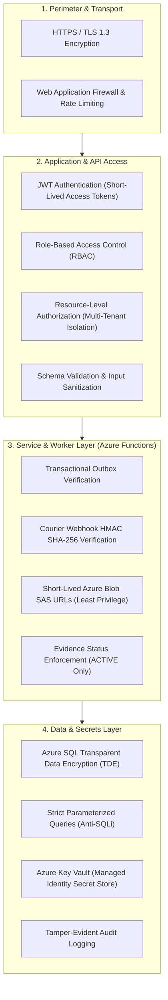

# 06. Security & Scalability Design

## 1. Security Architecture (Defense in Depth)

Causara enforces a **Defense-in-Depth** security model across client, network, application, database, and cloud infrastructure layers:

---

## 2. Authentication & Authorization Design

### 2.1 Multi-Layered Access Control
1. **Coarse-Grained (RBAC)**: Checks if the user holds the requisite role for the endpoint (e.g., only `MANAGER` can approve an intervention).
2. **Fine-Grained (Resource-Level / Multi-Tenancy)**: Enforces record ownership. A user with the `SELLER` role can only inspect or modify orders that carry their respective `seller_id`. Similarly, investigations and decisions enforce that `decision_case.order_id` belongs to the requesting seller.

### 2.2 Password Security
- **Algorithm**: `Argon2id` (memory-hard, resistant to GPU/ASIC cracking) with unique per-user salts.
- **Complexity**: Minimum 10 characters, requiring uppercase, lowercase, numbers, and special characters.
- **Account Lockout**: Exponential backoff throttling after 5 consecutive failed login attempts.

### 2.3 Token Architecture
- **Access Tokens**: Short-lived (15 minutes), signed using RS256/HS256 with secrets sourced from Azure Key Vault. Claims contain `user_id`, `email`, and `roles`.
- **Refresh Tokens**: Long-lived (7 days), stored hashed in Azure SQL, supporting rotation and instant revocation on logout or compromise.
- **Client Storage**: Refresh tokens are served via `HttpOnly`, `Secure`, `SameSite=Strict` cookies to eliminate JavaScript token-theft vectors.

---

## 3. Web Threat Mitigation

| Vulnerability | Attack Vector | Causara Defensive Countermeasure |
|---|---|---|
| **SQL Injection (SQLi)** | Arbitrary SQL execution via input parameters | Strict parameterized queries and ORM query builders. No raw SQL string formatting is permitted. |
| **Cross-Site Scripting (XSS)** | Malicious JavaScript injection into order descriptions or customer explanations | Automatic DOM escaping via React JSX, strict Content Security Policy (CSP) headers, and backend string sanitization. |
| **Cross-Site Request Forgery (CSRF)** | Unauthorized browser-driven state mutation | All mutating endpoints require `Authorization: Bearer <token>` headers; cookies use `SameSite=Strict`. |
| **Broken Object Level Auth (BOLA/IDOR)** | Modifying URL IDs (`/orders/102`, `/cases/9001`) to view another seller's order or case | Controllers validate that `order.seller_id == current_user.seller_id` before querying or mutating records. |
| **Webhook Replay Attacks** | Re-sending captured courier event payloads | Providers supply HMAC-SHA256 signatures in headers verified against a shared secret. Payloads include timestamps verified within a 5-minute clock drift window. |
| **Denial of Service (DoS)** | Volumetric API flooding or rapid-fire analysis triggers | Rate limiting configured per IP and user account (e.g., 60 req/min for general endpoints; 5 req/min for analysis triggers). |

---

## 4. Cloud Infrastructure Security

### 4.1 Secret Management with Azure Key Vault
- **Zero Committed Secrets**: No database passwords, JWT signing keys, or cloud storage keys are committed to Git repositories or hardcoded in source.
- **Managed Identities**: Both Azure App Service and Azure Functions connect to Azure Key Vault using system-assigned Azure Managed Identities without hardcoded credentials or connection strings in code.

### 4.2 Data Storage Protection & Evidence Integrity
- **Encryption at Rest**: Azure SQL Transparent Data Encryption (TDE) with service-managed keys; Azure Blob Storage and Cosmos DB encryption enabled by default.
- **Direct-to-Blob Least Privilege**: Upload SAS tokens grant write-only permissions scoped to a single generated blob path, expiring in 15 minutes. Public container access is strictly disabled.
- **Evidence Lifecycle Enforcement**: Evidence records in `PENDING_UPLOAD` or `FAILED` state cannot be viewed, downloaded, or attached to delay reports. Download SAS URLs are strictly restricted to verified `ACTIVE` evidence records.
- **Binary Integrity Verification**: Upon upload completion (`/evidence/{id}/complete`), the backend verifies blob presence, computes its SHA-256 hash, and stores it in `evidence.sha256_hash` to guarantee tamper resistance.

---

## 5. Scalability & Resilience Design

### 5.1 Asynchronous Load Decoupling via Azure Functions
Compute-intensive algorithms (delay graph construction, Monte Carlo scenario simulation) are isolated from HTTP request paths:
- API requests write intent to `analysis_jobs` and `outbox_events` within a single SQL transaction and immediately return `202 Accepted` or `201 Created`.
- A timer-triggered Azure Function (`outbox-dispatcher`) polls pending outbox messages and dispatches them to Azure Storage Queue.
- A queue-triggered Azure Function (`queue-processor`) consumes messages, executes reconstruction or scenario generation, and updates job status in Azure SQL, ensuring the Flask REST API remains fast and unblocked.

### 5.2 Database Performance Optimization
- Targeted non-clustered indexes on high-cardinality foreign keys and lookup columns (`email`, `seller_id`, `occurred_at`, `case_id`).
- Read-heavy analytics (e.g., seller dashboards, stage summaries) query optimized SQL Views (`vw_SellerDelaySummary`, `vw_OrderStageDelayBreakdown`).
- Semi-structured scenario JSON documents are offloaded to Azure Cosmos DB to prevent transactional SQL table bloat.

### 5.3 Stateless Horizontal Scalability
- The Flask REST API maintains no local session state in memory. Any instance can service any request.
- Azure App Service scale-out rules can automatically spin up additional container instances based on CPU and memory thresholds.
- Azure Functions scale dynamically and independently based on the number of messages waiting in the Azure Storage Queue.
