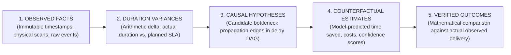
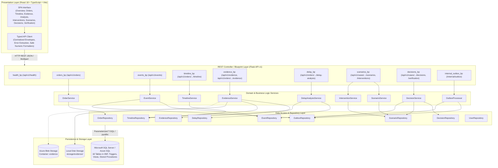
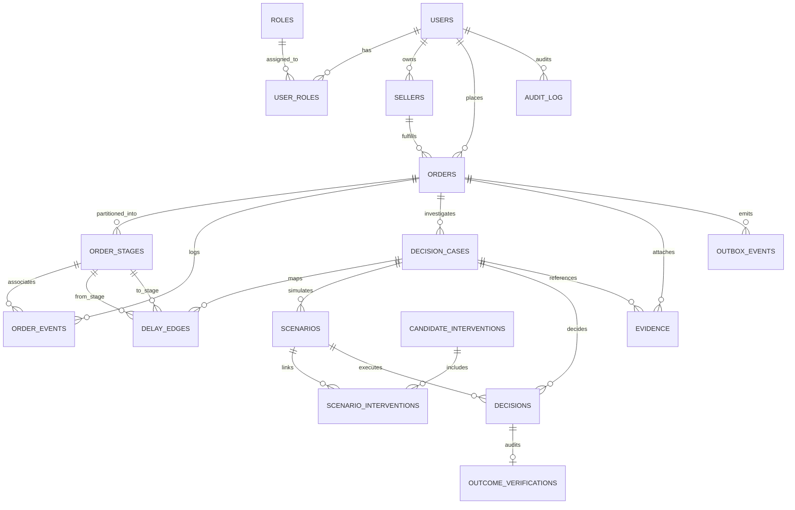
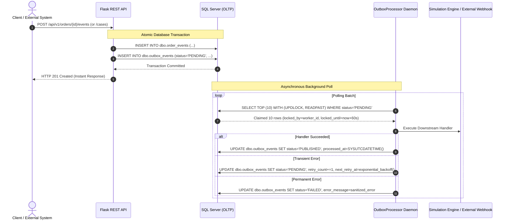

# CAUSARA — COMPREHENSIVE SYSTEM ARCHITECTURE & TECHNICAL OVERVIEW

> **Explain Delays. Discover Interventions. Improve Decisions.**  
> An explainable e-commerce order delay intelligence, root-cause diagnosis, counterfactual intervention analysis, and outcome verification platform.

---

## 1. Executive Summary & Vision

In conventional e-commerce logistics, delivery tracking is fundamentally opaque. When a shipment misses its promised delivery date, customers and merchants are typically greeted with a generic, uninformative status message such as *"Delayed in transit"*. This opacity introduces severe operational deficiencies:
1. **Opaque Timeline Aggregation**: The timeline does not isolate whether the delay originated during inventory reservation, warehouse picking and packing, carrier dispatch handover, regional linehaul transit, or local last-mile hub operations.
2. **Conflating Correlation with Causation**: Dashboards frequently blame whichever logistics carrier handled the package last, completely ignoring compounding upstream bottlenecks (e.g., a 26-hour warehouse packing delay that caused an order to miss a scheduled regional linehaul freight departure).
3. **Unverified Interventions**: When sellers take corrective action (e.g., paying for priority courier upgrades, re-routing through air freight, or dispatching replacement stock), there is rarely a structured feedback mechanism to verify whether the intervention actually produced the anticipated time savings.
4. **Absence of Auditable Governance**: Operations managers lack structured audit trails documenting why specific expediting actions were chosen, what assumptions were modeled, who authorized the expenditures, and what the actual operational outcome was.

**Causara** is built to solve these structural problems through an explainable, end-to-end intelligence platform that:
- Ingests physical milestone events with cryptographic integrity and dual timestamps (`occurred_at` vs. `received_at`).
- Reconstructs immutable, chronological order timelines across distinct operational stages.
- Diagnoses positive and negative stage variances against planned Service Level Agreements (SLAs).
- Synthesizes directed delay-chain propagation graphs that distinguish physical transitions from causal hypotheses.
- Discovers and evaluates candidate counterfactual interventions based on time recovered, monetary cost, operational risk, and statistical confidence.
- Records auditable human-in-the-loop decisions with multi-role approval governance.
- Closed-loop verifies predicted outcomes against actual observed delivery events, calculating signed and absolute prediction errors without data fabrication.

---

## 2. Core Domain Philosophy: The Epistemological Framework

Causara enforces a foundational domain rule: **never present correlation as proven causation**. To maintain complete scientific and operational integrity, all data presented across the APIs and frontend interfaces is categorized into five distinct epistemological classes:



| Epistemological Class | Definition & Semantic Meaning | Practical Representation in Causara |
|---|---|---|
| **Observed Facts** | Objective, immutable records of physical events directly recorded by sensors, warehouse scanners, or courier webhooks. | Order creation timestamps, stage transition events (`ORDER_PLACED`, `PACKING_COMPLETED`, `DISPATCH_INITIATED`), physical evidence uploads with SHA-256 hashes. |
| **Duration Variances** | Pure arithmetic deviations between planned SLA duration and actual observed duration for a specific lifecycle stage. | `variance_minutes = actual_duration_minutes - planned_duration_minutes`. If positive, indicates an excess duration; if negative, indicates time recovered. |
| **Causal Hypotheses** | Inferred relationships suggesting that excess duration in an upstream stage caused or contributed to downstream SLA failures. | Directed acyclic graph (DAG) edges categorized as `BOTTLENECK_PROPAGATION` with explicit qualitative rationales. |
| **Counterfactual Estimates** | Projections derived from simulation models indicating the expected impact of alternative remediation strategies. | Scenarios containing predicted time saved (e.g. `+240 min`), estimated monetary costs (e.g. `$25.00`), risk levels (`LOW`, `MEDIUM`, `HIGH`), and confidence scores (e.g. `88%`). |
| **Verified Outcomes** | Closed-loop mathematical comparison between what was predicted and what actually occurred upon terminal delivery. | Signed prediction error ($E_{\text{signed}} = T_{\text{actual}} - T_{\text{predicted}}$) and absolute error ($E_{\text{abs}} = \|E_{\text{signed}}\|$). |

---

## 3. High-Level & Low-Level System Architecture

Causara follows a **Modular Monolith** architecture with strict separation of concerns, clean domain boundaries, and asynchronous background processing capabilities.

### 3.1 End-to-End System Context Diagram



### 3.2 Layer Responsibilities & Design Patterns

1. **Presentation Layer (`frontend/src/`)**:
   - Implemented as a Single Page Application (SPA) using React 18, TypeScript, and Vite.
   - Strictly enforces **zero hardcoded operational data**; every metric, card, table, and dropdown is populated via live API calls.
   - Safe numeric formatting (`frontend/src/utils/formatters.ts`) prevents UI crashes on SQL DECIMAL string serializations while honestly differentiating genuine zeros (`$0.00`, `0%`) from missing estimates (`"—"`).
2. **REST Controller Layer (`app/api/`)**:
   - Organized into modular Flask Blueprints registered under `/api/v1/` prefix.
   - Enforces uniform JSON response envelopes:
     - Success: `{ "success": true, "data": <payload>, "meta": { "request_id": "...", "timestamp": "..." } }`
     - Error: `{ "success": false, "error": { "code": "...", "message": "...", "details": ... }, "meta": { ... } }`
   - Request tracing via `X-Request-ID` request headers.
3. **Application & Domain Service Layer (`app/services/`)**:
   - Contains pure business logic, orchestration, validation, calculations, and domain guardrails.
   - Fully decoupled from HTTP transport and presentation logic.
   - Enforces transactional boundaries using database context managers.
4. **Data Access Repository Layer (`app/repositories/`)**:
   - Dedicated repository per aggregate root.
   - Executes strictly parameterized SQL queries to prevent SQL injection vulnerabilities.
   - Translates raw `pyodbc.Row` instances into typed dictionaries.
5. **Transactional Outbox Engine (`OutboxProcessor`)**:
   - Implements reliable asynchronous messaging between operational transactions and background processors.
   - Uses atomic row-level claiming with SQL Server `WITH (UPDLOCK, READPAST)`.
   - Supports lease expiration, exponential backoff retries, and poisoned-message dead-letter isolation.

---

## 4. Database Architecture & 18-Table 3NF Deep Dive

Causara uses **Microsoft SQL Server** (local development using LocalDB, production ready for Azure SQL Database) as its transactional source of truth. The relational schema is structured in strict Third Normal Form (3NF).

### 4.1 Entity Relationship Diagram (ERD)



### 4.2 Comprehensive 18-Table Schema Catalog

| # | Table Name | Purpose & Business Semantics | Key Columns & Constraints |
|---|---|---|---|
| 1 | `dbo.roles` | Reference catalog of authorization roles within the platform. | `role_id` (PK), `role_code` (UQ, e.g. `CUSTOMER`, `SELLER`, `ANALYST`, `MANAGER`, `AUDITOR`, `ADMIN`), `role_name`, `created_at`. |
| 2 | `dbo.users` | Registered user identities, authentication hashes, and account states. | `user_id` (PK, IDENTITY), `full_name`, `email` (UQ), `password_hash`, `is_active` (DEFAULT 1), `created_at`. |
| 3 | `dbo.user_roles` | Many-to-many junction mapping users to assigned system roles. | Composite PK (`user_id`, `role_id`), FKs to `users` and `roles`. |
| 4 | `dbo.sellers` | Merchant business entities responsible for fulfilling orders. | `seller_id` (PK, IDENTITY), `owner_user_id` (FK to `users`), `business_name`, `created_at`. |
| 5 | `dbo.orders` | Authoritative order master record capturing placement and delivery targets. | `order_id` (PK, IDENTITY), `seller_id` (FK), `customer_user_id` (FK), `external_order_ref` (UQ), `placed_at`, `expected_delivery_at`, `actual_delivery_at`, `status` (CHECK constraint: `PLACED`, `PROCESSING`, `DISPATCHED`, `IN_TRANSIT`, `DELIVERED`, `DELAYED`, `CANCELLED`). |
| 6 | `dbo.order_stages` | Sequential operational milestones defining an order's lifecycle. | `stage_id` (PK, IDENTITY), `order_id` (FK), `stage_code` (e.g. `SELLER_PROCESSING`, `DISPATCH`, `LINEHAUL_TRANSPORT`, `LAST_MILE`, `DELIVERED`), `sequence_no`, `planned_start_at`, `planned_end_at`, `actual_start_at`, `actual_end_at`, `status` (`PENDING`, `IN_PROGRESS`, `COMPLETED`, `SKIPPED`). Composite UQ (`order_id`, `stage_code`). |
| 7 | `dbo.order_events` | Immutable stream of operational tracking events received from all actors/systems. | `event_id` (PK, IDENTITY), `order_id` (FK), `stage_id` (FK, NULL), `idempotency_key` (UQ), `event_type` (`ORDER_PLACED`, `PACKING_DELAYED`, `PACKING_COMPLETED`, etc.), `source_type` (`SYSTEM`, `CARRIER_WEBHOOK`, `MANUAL_ENTRY`, `IOT_SENSOR`), `occurred_at`, `received_at`, `payload_json`. |
| 8 | `dbo.decision_cases` | Active operational delay investigation instances for delayed orders. | `case_id` (PK, IDENTITY), `order_id` (FK), `opened_by` (FK), `case_status` (`OPEN`, `INVESTIGATING`, `INTERVENTION_PROPOSED`, `CLOSED`), `primary_delay_stage_id` (FK, NULL), `opened_at`, `closed_at`. |
| 9 | `dbo.evidence` | Physical or digital evidence records verifying operational disruptions. | `evidence_id` (PK, IDENTITY), `order_id` (FK), `stage_id` (FK, NULL), `event_id` (FK, NULL), `case_id` (FK, NULL), `uploaded_by` (FK), `blob_uri` (UQ), `file_name`, `content_type`, `sha256_hash`, `status` (`PENDING_UPLOAD`, `ACTIVE`, `ARCHIVED`). |
| 10 | `dbo.delay_edges` | Directed acyclic graph (DAG) edges representing delay propagation pathways. | `edge_id` (PK, IDENTITY), `case_id` (FK), `from_stage_id` (FK), `to_stage_id` (FK), `edge_type` (`STAGE_TRANSITION`, `BOTTLENECK_PROPAGATION`, `CORRELATION`), `evidence_class` (`FACT`, `HYPOTHESIS`, `ESTIMATE`), `estimated_delay_minutes`, `explanation`. |
| 11 | `dbo.candidate_interventions` | Reusable operational remediation actions available to resolve bottlenecks. | `intervention_id` (PK, IDENTITY), `intervention_code` (UQ), `name`, `intervention_type` (`PRIORITY_PACKING`, `AIR_FREIGHT_REROUTE`, `CARRIER_EXPEDITE`, `CUSTOMER_PROACTIVE_NOTICE`), `applicable_stage_code`, `rationale`, `preconditions`, `expected_time_saved_minutes`, `estimated_cost` (DECIMAL), `risk_level` (`LOW`, `MEDIUM`, `HIGH`). |
| 12 | `dbo.scenarios` | Simulated combinations of interventions evaluated to remediate delays. | `scenario_id` (PK, IDENTITY), `case_id` (FK), `scenario_name`, `status` (`PENDING_PERSISTENCE`, `READY`, `FAILED`), `predicted_time_saved_minutes`, `estimated_cost` (DECIMAL), `risk_level`, `confidence_score` (DECIMAL 0.00-1.00), `cosmos_document_id`, `model_version`, `created_at`. |
| 13 | `dbo.scenario_interventions` | Junction associating candidate interventions into composite scenarios. | Composite PK (`scenario_id`, `intervention_id`), `estimated_cost_contribution`. |
| 14 | `dbo.decisions` | Traceable management decisions selecting a scenario for physical execution. | `decision_id` (PK, IDENTITY), `case_id` (FK), `scenario_id` (FK), `decided_by` (FK), `approved_by` (FK, NULL), `decision_status` (`PENDING`, `APPROVED`, `REJECTED`, `EXECUTED`), `rationale`, `selected_at`, `approved_at`. |
| 15 | `dbo.outcome_verifications` | Post-delivery mathematical verification records comparing forecasts to actuals. | `verification_id` (PK, IDENTITY), `decision_id` (FK, UQ), `measured_at`, `original_expected_delivery_at`, `baseline_estimated_delivery_at`, `predicted_delivery_at`, `actual_delivery_at`, `signed_prediction_error_minutes`, `absolute_prediction_error_minutes`, `delivery_variance_minutes`, `outcome_notes`. |
| 16 | `dbo.audit_log` | Immutable compliance log tracking every state mutation across the system. | `log_id` (PK, IDENTITY), `actor_user_id` (FK), `action`, `entity_type`, `entity_id`, `metadata_json`, `occurred_at`. |
| 17 | `dbo.outbox_events` | Asynchronous transactional outbox queue for event publication. | `outbox_id` (PK, IDENTITY), `event_type`, `aggregate_type`, `aggregate_id`, `payload_json`, `status` (`PENDING`, `PROCESSING`, `PUBLISHED`, `FAILED`), `retry_count`, `next_retry_at`, `locked_by`, `locked_until`, `created_at`, `processed_at`. |
| 18 | `dbo.schema_migrations` | Database version migration registry tracking applied migrations and integrity. | `version` (PK, VARCHAR 50), `description`, `applied_at`, `execution_time_ms`, `checksum` (SHA-256). |

### 4.3 Database Triggers, Views & Stored Procedures

#### Database Triggers
- `dbo.trg_delay_edges_order_stage_integrity`:
  - Enforces that `from_stage_id` and `to_stage_id` cannot be identical (rejects graph self-loops with error `50010`).
  - Enforces multi-row cross-order referential integrity: ensures `case_id`, `from_stage_id`, and `to_stage_id` all belong to the identical `order_id` (rejects cross-order corruption with error `50011`).
- `dbo.trg_order_stages_immutable_order`:
  - Protects order ownership immutability. Rejects any attempt to update `order_stages.order_id` after creation (error `50012`).
- `dbo.trg_decision_cases_immutable_order`:
  - Protects decision case immutability. Rejects any attempt to modify `decision_cases.order_id` (error `50013`).

#### Analytical Views
- `dbo.vw_SellerDelaySummary`:
  - Aggregates seller logistics metrics: `total_orders`, `delayed_orders`, `avg_fulfillment_hours`, and `avg_delay_hours`.
- `dbo.vw_OrderStageDelayBreakdown`:
  - Automatically calculates `planned_duration_minutes`, `actual_duration_minutes`, and `variance_minutes` for all stages with recorded start and completion timestamps.

#### Stored Procedures
- `dbo.usp_OpenDecisionCase`:
  - Validates order existence, checks for active open cases, atomically creates a new case record in `dbo.decision_cases`, writes an audit log entry, and emits an `ANALYSIS_JOB_QUEUED` event into `dbo.outbox_events` within a single atomic transaction.
- `dbo.usp_RecordDecision`:
  - Validates that the selected scenario belongs to the specified case (error `50004`), inserts a decision record in `PENDING` status, and logs the action to `dbo.audit_log`.
- `dbo.usp_ApproveDecision`:
  - Transitions a `PENDING` decision to `APPROVED`, records the approving manager's user ID and timestamp, emits a `DECISION_APPROVED` outbox event, and audits the transaction.
- `dbo.usp_VerifyPrediction`:
  - Validates delivery timestamps, calculates signed error ($T_{\text{actual}} - T_{\text{predicted}}$) and absolute error, calculates delivery variance, and persists the audit record in `dbo.outcome_verifications`.

---

## 5. Backend Architecture & "What Does What"

The backend is built in **Python 3.14** using the **Flask** application framework. It is organized into distinct services, repositories, and utility modules:

```text
app/
├── __init__.py               # Flask application factory (create_app), CORS, logging, lifecycle hooks
├── config.py                 # Centralized configuration (DevelopmentConfig, TestingConfig, ProductionConfig)
├── database/
│   ├── __init__.py
│   └── connection.py         # Pyodbc connection pooling, transactional context managers, health checks
├── api/
│   ├── __init__.py           # API v1 blueprint registration
│   ├── errors.py             # Standardized JSON error response handlers & APIError exceptions
│   ├── health.py             # Health probe (/api/v1/health)
│   ├── orders.py             # Order catalog, creation, and metrics routes
│   ├── events.py             # Event ingestion routes
│   ├── timeline.py           # Timeline reconstruction and stage inspection routes
│   ├── evidence.py           # Documentary evidence upload and listing routes
│   ├── delay.py              # Delay analysis and delay graph routes
│   ├── scenarios.py          # Candidate interventions and counterfactual simulation routes
│   ├── decisions.py          # Decision recording, approval, and outcome verification routes
│   ├── outbox.py             # Internal outbox metrics and monitoring routes
│   └── users.py              # User profiles and demo actor switching routes
├── repositories/             # Data access layer executing parameterized T-SQL
│   ├── order_repository.py
│   ├── event_repository.py
│   ├── timeline_repository.py
│   ├── evidence_repository.py
│   ├── delay_repository.py
│   ├── scenario_repository.py
│   ├── decision_repository.py
│   ├── outbox_repository.py
│   └── user_repository.py
└── services/                 # Domain logic and orchestration
    ├── order_service.py
    ├── event_service.py
    ├── timeline_service.py
    ├── evidence_service.py
    ├── delay_service.py
    ├── intervention_service.py
    ├── scenario_service.py
    ├── decision_service.py
    └── outbox_processor.py
```

### 5.1 Service Layer Walkthrough

#### 1. `OrderService` (`app/services/order_service.py`)
- **What it does**: Handles order creation and catalog querying.
- **Key behaviors**:
  - Automatically provisions the standard 5-stage fulfillment pipeline (`SELLER_PROCESSING`, `DISPATCH`, `LINEHAUL_TRANSPORT`, `LAST_MILE`, `DELIVERED`) whenever a new order is ingested.
  - Automatically derives default planned SLA start and end timestamps based on order placement date and target delivery window.
  - Computes global fulfillment statistics (total orders, active fulfillment, delivered count, active investigation count).

#### 2. `EventService` (`app/services/event_service.py`)
- **What it does**: Ingests physical event updates from carriers, systems, and operators.
- **Key behaviors**:
  - **Dual Timestamping**: Ingests `occurred_at` (event occurrence in physical world) while capturing `received_at` (server ingestion timestamp) in UTC.
  - **Idempotency Guarantee**: If an event with an existing `idempotency_key` arrives with matching payload, it safely replays the existing record without duplicating state.
  - **Idempotency Conflict Rejection**: If an existing key arrives with a conflicting payload, it raises HTTP 409 (`IDEMPOTENCY_KEY_CONFLICT`).
  - **Transactional Outbox Emission**: Simultaneously writes an event publication record into `dbo.outbox_events` inside the same database transaction.

#### 3. `TimelineService` (`app/services/timeline_service.py`)
- **What it does**: Reconstructs an order's physical history into an immutable, chronological timeline.
- **Key behaviors**:
  - Sorts events chronologically by `occurred_at` with deterministic tie-breaking.
  - Maps physical events to stage transitions (e.g. `PACKING_DELAYED` marks `SELLER_PROCESSING` as delayed; `PACKING_COMPLETED` completes the stage and initiates `DISPATCH`).
  - Recomputes actual durations and variances for all stages:
    $$\text{variance\_minutes} = \text{actual\_duration} - \text{planned\_duration}$$
  - Flags anomalies such as missing intermediate stages, out-of-order scans, or abnormal duration spikes.

#### 4. `EvidenceService` (`app/services/evidence_service.py`)
- **What it does**: Manages physical evidence attachments (PDFs, courier receipts, incident logs).
- **Key behaviors**:
  - Validates file sizes ($\le 10\text{ MB}$) and MIME types (`application/pdf`, `image/png`, `image/jpeg`, etc.).
  - Calculates SHA-256 cryptographic digest over the binary payload.
  - Enforces cross-order referential isolation: guarantees that linked `event_id` or `case_id` actually belongs to the specified `order_id`.
  - Supports dual storage providers:
    - `LocalStorageProvider`: Writes files locally to `storage/evidence/{order_id}/{hash}_{filename}`.
    - `AzureBlobStorageProvider`: Uploads directly to an Azure Blob Storage container (`evidence`).
  - **Fail-Fast Invariant**: If Azure storage is configured (`STORAGE_PROVIDER=azure`) but credentials or connectivity are missing, it throws an immediate error and **never silently falls back to local disk**.

#### 5. `DelayAnalysisService` (`app/services/delay_service.py`)
- **What it does**: Analyzes stage variances to isolate bottlenecks and construct delay propagation DAGs.
- **Key behaviors**:
  - Scans reconstructed stage metrics to identify the primary delay stage (the stage with the largest positive duration variance).
  - Categorizes findings into the 4-quadrant epistemological taxonomy (Facts, Variances, Hypotheses, Estimates).
  - Synthesizes directed delay graph edges:
    - `STAGE_TRANSITION`: Physical sequence between consecutive stages (`FACT`).
    - `BOTTLENECK_PROPAGATION`: Inferred causal links where upstream delay compressed downstream buffers (`HYPOTHESIS`).

#### 6. `InterventionService` & `ScenarioService` (`app/services/`)
- **What it does**: Discovers candidate interventions and models counterfactual remediation scenarios.
- **Key behaviors**:
  - `InterventionService`: Filters candidate interventions applicable to the active bottleneck stage (e.g. `PRIORITY_PACKING` for warehouse delays; `AIR_FREIGHT_REROUTE` for linehaul delays).
  - `ScenarioService`: Generates multi-intervention scenarios, calculating cumulative predicted time saved, total estimated cost, composite risk rating, and model confidence score ($0.00 - 1.00$).

#### 7. `DecisionService` (`app/services/decision_service.py`)
- **What it does**: Manages human-in-the-loop decision governance and post-delivery verification.
- **Key behaviors**:
  - `record_decision`: Records a proposed intervention scenario in `PENDING` state with documented business rationale.
  - `approve_decision`: Validates manager authority and updates decision status to `APPROVED`, emitting a `DECISION_APPROVED` outbox event.
  - `verify_outcome`: Upon order delivery, benchmarks the final actual delivery timestamp against the original target, baseline estimate, and predicted delivery time:
    $$E_{\text{signed}} = T_{\text{actual}} - T_{\text{predicted}}$$
    $$E_{\text{abs}} = |E_{\text{signed}}|$$

#### 8. `OutboxProcessor` (`app/services/outbox_processor.py`)
- **What it does**: Background processor consuming pending transactional outbox events.
- **Key behaviors**:
  - Unique worker identification (`worker_id = f"worker-{uuid4()}"`).
  - Atomic row claiming using SQL Server concurrency hints:
    ```sql
    SELECT TOP (@BatchSize) outbox_id, event_type, payload_json
    FROM dbo.outbox_events WITH (UPDLOCK, READPAST)
    WHERE status = 'PENDING' AND (next_retry_at IS NULL OR next_retry_at <= SYSUTCDATETIME());
    ```
  - Optimistic lease verification on acknowledgement to ensure crashed or timed-out workers cannot corrupt messages reclaimed by another worker.
  - Exponential backoff retry delays with jitter. Permanent errors immediately transition to `FAILED` status without retry waste.

---

## 6. Complete REST API Specification

All endpoints are hosted under the prefix `/api/v1/`.

| Group | Method | Path | Request Body | Response Success | Error Codes |
|---|---|---|---|---|---|
| **Health** | `GET` | `/api/v1/health` | None | `200 OK` (service, version, db connectivity status) | `503 SERVICE_UNAVAILABLE` |
| **Orders** | `GET` | `/api/v1/orders` | Query params: `limit`, `offset`, `status`, `seller_id` | `200 OK` (list of orders, total count, pagination metadata) | `400 BAD_REQUEST` |
| | `POST` | `/api/v1/orders` | `{ seller_id, customer_user_id, external_order_ref, placed_at, expected_delivery_at }` | `201 CREATED` (created order object with 5 default stages) | `400 VALIDATION_ERROR`, `409 DUPLICATE_ORDER_REF` |
| | `GET` | `/api/v1/orders/{id}` | None | `200 OK` (order object, stages list, active case ID) | `404 ORDER_NOT_FOUND` |
| | `GET` | `/api/v1/orders/stats` | None | `200 OK` (total_orders, active_fulfillment, delivered, active_cases, cancelled) | None |
| **Events** | `POST` | `/api/v1/events` | `{ order_id, stage_id?, event_type, source_type, idempotency_key, occurred_at, payload_json? }` | `201 CREATED` / `200 OK` on idempotent replay | `400 VALIDATION_ERROR`, `404 ORDER_NOT_FOUND`, `409 IDEMPOTENCY_CONFLICT` |
| **Timeline** | `GET` | `/api/v1/orders/{id}/timeline` | None | `200 OK` (order_id, status, stages array with planned/actual durations, events array) | `404 ORDER_NOT_FOUND` |
| | `POST` | `/api/v1/orders/{id}/timeline/reconstruct` | None | `200 OK` (reconstructed timeline payload) | `404 ORDER_NOT_FOUND` |
| **Evidence** | `POST` | `/api/v1/orders/{id}/evidence` | Multipart Form: `file`, `uploaded_by`, `content_type` OR JSON metadata | `201 CREATED` (evidence_id, blob_uri, sha256_hash, completed_at) | `400 BAD_REQUEST`, `404 NOT_FOUND`, `413 FILE_TOO_LARGE`, `415 UNSUPPORTED_MEDIA` |
| | `GET` | `/api/v1/orders/{id}/evidence` | Query params: `stage_id?`, `case_id?`, `event_id?` | `200 OK` (list of evidence records) | `404 ORDER_NOT_FOUND` |
| | `GET` | `/api/v1/evidence/{id}` | None | `200 OK` (evidence metadata record) | `404 RESOURCE_NOT_FOUND` |
| **Delay** | `GET` | `/api/v1/orders/{id}/delay-analysis` | None | `200 OK` (stage_metrics, delay_graph, epistemological_breakdown: facts, variances, hypotheses, estimates) | `404 ORDER_NOT_FOUND` |
| **Interventions** | `GET` | `/api/v1/cases/{case_id}/interventions` | None | `200 OK` (list of candidate interventions matching bottleneck stage) | `404 CASE_NOT_FOUND` |
| **Scenarios** | `GET` | `/api/v1/cases/{case_id}/scenarios` | None | `200 OK` (list of simulated scenarios with cost, savings, risk, confidence) | `404 CASE_NOT_FOUND` |
| | `POST` | `/api/v1/cases/{case_id}/scenarios` | `{ scenario_name, intervention_ids: [...] }` | `201 CREATED` (simulated scenario object) | `400 VALIDATION_ERROR`, `404 CASE_NOT_FOUND` |
| **Decisions** | `GET` | `/api/v1/cases/{case_id}/decisions` | None | `200 OK` (list of decisions with status, rationale, approver) | `404 CASE_NOT_FOUND` |
| | `POST` | `/api/v1/cases/{case_id}/decisions` | `{ scenario_id, decided_by, rationale }` | `201 CREATED` (decision object in PENDING status) | `400 VALIDATION_ERROR`, `404 SCENARIO_NOT_FOUND` |
| | `POST` | `/api/v1/decisions/{id}/approve` | `{ manager_user_id }` | `200 OK` (decision updated to APPROVED) | `400 INVALID_STATE`, `404 DECISION_NOT_FOUND` |
| **Verification** | `GET` | `/api/v1/decisions/{id}/verification` | None | `200 OK` (verification record with signed and absolute error) | `404 VERIFICATION_NOT_FOUND` |
| | `POST` | `/api/v1/decisions/{id}/verification` | `{ actual_delivery_at, outcome_notes? }` | `201 CREATED` (persisted outcome verification) | `400 VALIDATION_ERROR`, `404 DECISION_NOT_FOUND` |
| **Outbox** | `GET` | `/internal/outbox/stats` | Header: `X-Internal-API-Key` or `Bearer <key>` | `200 OK` (pending_count, processing_count, published_count, failed_count, oldest_age) | `401 UNAUTHORIZED` |
| **Users** | `GET` | `/api/v1/users/actors` | None | `200 OK` (list of active demo actors for role switching) | None |

---

## 7. Frontend Architecture & The 9-Page Workflow

The frontend is written in **React 18** and **TypeScript** with Vite. It features a responsive layout with a dark navy navigation sidebar (`#0f172a`) and a clean, high-contrast workspace (`#f8fafc`).

### 7.1 Architecture & Component Hierarchy

```text
frontend/src/
├── main.tsx                  # React DOM mount point
├── App.tsx                   # Master router, tab switching, global notification banners
├── index.css                 # Causara design system tokens, CSS variables, global resets
├── types/
│   └── api.ts                # Strict TypeScript interfaces matching backend v1 contracts
├── services/
│   └── api.ts                # Centralized typed HTTP client with error parsing & request signals
├── utils/
│   ├── formatters.ts         # Safe numeric, currency, and percentage formatting helpers
│   └── formatters.test.ts    # Vitest suite verifying edge cases and fallbacks
├── components/
│   ├── layout/
│   │   ├── Header.tsx        # Top navbar with live status indicator and Actor Switcher
│   │   ├── Sidebar.tsx       # Dark navy navigation sidebar across all 9 pages
│   │   └── Layout.tsx        # Outer shell combining sidebar, header, and content viewport
│   └── common/
│       ├── Alert.tsx         # Notification alerts (info, success, warning, error)
│       ├── Badge.tsx         # Status and epistemological taxonomy badges
│       ├── Button.tsx        # Styled interaction buttons with loading spinners
│       ├── Card.tsx          # Metric cards and structured content containers
│       ├── EmptyState.tsx    # Clean placeholder when records are absent
│       ├── LoadingSpinner.tsx# Centered asynchronous activity indicator
│       ├── Modal.tsx         # Accessible overlay dialogue for creation workflows
│       └── Table.tsx         # Reusable data table with sort and filter capabilities
└── pages/
    ├── OverviewPage.tsx      # High-level operational dashboard and KPI counters
    ├── OrdersPage.tsx        # Order catalog, stage drawer, and creation modal
    ├── TimelinePage.tsx      # Chronological event sequence and stage SLA progress bars
    ├── EvidencePage.tsx      # Attached document repository with SHA-256 inspection
    ├── DelayAnalysisPage.tsx # Bottleneck isolation, epistemological breakdown, delay graph
    ├── InterventionsPage.tsx # Catalog of discovered remedies for current bottleneck
    ├── ScenariosPage.tsx     # Counterfactual simulation comparison matrix and simulator
    ├── DecisionsPage.tsx     # Governance workflow for recording and approving interventions
    └── VerificationPage.tsx  # Closed-loop post-delivery audit and prediction error display
```

### 7.2 The 9-Page Operational Journey

```mermaid
flowchart LR
    P1["1. Overview\n(Live Stats)"] --> P2["2. Orders\n(Select Consignment)"]
    P2 --> P3["3. Timeline\n(Identify Variance)"]
    P3 --> P4["4. Evidence\n(Audit Physical Proof)"]
    P4 --> P5["5. Delay Analysis\n(Isolate Root Cause)"]
    P5 --> P6["6. Interventions\n(Review Options)"]
    P6 --> P7["7. Scenarios\n(Simulate Counterfactuals)"]
    P7 --> P8["8. Decisions\n(Approve Remediation)"]
    P8 --> P9["9. Verification\n(Benchmark Accuracy)"]
```



1. **Overview (`/`)**: Displays real-time operational statistics queried directly from SQL Server: total orders, active fulfillment, delivered count, open investigation cases, and cancelled shipments. Features recent order activity and the core epistemological rule disclaimer.
2. **Orders (`/orders`)**: Comprehensive order catalog with status filters (`ALL`, `PROCESSING`, `IN_TRANSIT`, `DELIVERED`, `DELAYED`, `CANCELLED`). Selecting an order opens an expandable details drawer showing all 5 fulfillment stages with direct deep-links to downstream analysis. Includes an *“Ingest New Order”* creation modal.
3. **Timeline (`/timeline`)**: Reconstructs the selected order's end-to-end journey. Displays horizontal SLA bars highlighting stage variances (e.g. `+1560 min` in warehouse packaging) followed by an immutable chronological event log with UTC timestamps and source badges.
4. **Evidence (`/evidence`)**: Displays documentary records verifying disruptions. Features cryptographic SHA-256 hash inspection, file size metadata, and uploader attribution. Supports multi-part file uploads without data corruption.
5. **Delay Analysis (`/analysis`)**: Automatically detects whether an order is delayed, computes total delivery variance, and isolates the primary bottleneck stage. Separates data into the 4-quadrant epistemological taxonomy (Facts, Variances, Hypotheses, Estimates) and visualizes the delay propagation DAG.
6. **Interventions (`/interventions`)**: Discovers and lists applicable operational remedies tailored to the active bottleneck stage, displaying predicted recovery times, costs, preconditions, and risk classifications.
7. **Scenario Simulator (`/scenarios`)**: Compares multiple intervention scenarios side-by-side. Safely renders financial costs (`$25.00`) and confidence percentages (`88%`). Features an interactive *“Simulate Custom Scenario”* modal allowing operators to bundle multiple interventions and predict outcomes.
8. **Decisions (`/decisions`)**: The operational governance workspace. Displays recorded intervention choices, business rationales, predicted savings, and author attribution. Operations Managers can execute formal *Approve* or *Reject* actions with full audit logging.
9. **Outcome Verification (`/verification`)**: Upon order delivery, benchmarks the predicted delivery timestamp against the actual delivery timestamp. Calculates mathematical prediction errors ($E_{\text{signed}}$ and $E_{\text{abs}}$) and delivery variance, closing the operational feedback loop.

---

## 8. Asynchronous Reliability: The Transactional Outbox Engine

To prevent HTTP request handlers from blocking on heavy computation or external network calls, Causara implements the **Transactional Outbox Pattern**:



### Key Concurrency Invariants
- **Atomic Concurrency (`UPDLOCK, READPAST`)**: Multiple concurrent worker instances can read from `dbo.outbox_events` simultaneously without deadlocking or claiming the same record.
- **Lease Expiration**: If a worker node crashes mid-batch, its lease (`locked_until`) naturally expires, allowing healthy workers to safely reclaim the orphaned message.
- **Optimistic Lease Verification**: When a worker finishes processing, its acknowledgement query verifies that `locked_by` still matches its unique worker ID, preventing a delayed worker from double-acknowledging a stolen task.
- **Exponential Backoff**: Transient failures back off geometrically ($2^{\text{retry\_count}} \times 2\text{ seconds}$) up to a hard cap, preventing worker storms during downstream outages.

---

## 9. Demonstration Cases & Seed Scenarios

Causara includes a deterministic, safe-to-rerun seed script (`database/seed_demo_data.py`) that populates four real-world logistics consignments:

| Order Reference | Internal ID | Final Status | Scenario Description & Included Data |
|---|---|---|---|
| `ORD-DEMO-ONTIME-001` | `#191153` | `DELIVERED` | **Baseline On-Time Order**: Progresses smoothly through all 5 fulfillment stages without incident. Demonstrates zero-variance behavior and baseline SLA tracking. |
| `ORD-DEMO-WAREHOUSE-002` | `#191154` | `PROCESSING` | **Warehouse Bottleneck Case (Primary Demo)**: Suffers an inventory picking delay of `+1560 minutes` in `SELLER_PROCESSING`. Includes attached PDF incident log (`#80054`), active decision case (`#110490`), delay propagation graph, simulated scenario (`#100097`, *"Priority Packaging & Dispatch Acceleration"*, `$25.00`, `+240 min` savings, `88%` confidence), and approved decision (`#80076`). |
| `ORD-DEMO-TRANSPORT-003` | `#191155` | `DELIVERED` | **Transit Delay Case**: Experienced a regional transit disruption during `LINEHAUL_TRANSPORT` (`+1200 min`). Features transit evidence and closed-loop outcome verification. |
| `ORD-DEMO-CANCELLED-004` | `#191156` | `CANCELLED` | **Pre-Dispatch Cancellation**: Customer cancelled order during warehouse packaging. Demonstrates clean terminal state transition and skipped downstream stages. |

---

## 10. How It Is Built & How It Runs

### 10.1 Technology Inventory

```text
Backend:
- Python 3.14.2 (64-bit)
- Flask 3.1.0 (REST micro-framework)
- Flask-CORS 5.0.0 (Cross-Origin Resource Sharing)
- pyodbc 5.3.0 (ODBC database interface)
- azure-storage-blob 12.31.1 (Azure Object Storage SDK)
- python-dotenv 1.0.1 (Environment configuration)
- pytest 9.2.0 (Automated test runner)
- flake8 7.1.1 (PEP 8 code quality auditor)

Frontend:
- Node.js v24.11.1 / npm 11.11.0
- React 18.3.1 (Component library)
- TypeScript 5.4.5 (Strict type checking)
- Vite 5.2.0 (Bundler & local development server)
- Vitest 1.4.0 (Unit test runner)
- React Testing Library (Component DOM tests)

Database:
- Microsoft SQL Server 2019/2022 / Express LocalDB
- ODBC Driver 17 / 18 for SQL Server
- 18 Tables in 3NF, 3 Triggers, 2 Views, 4 Stored Procedures
```

### 10.2 Local Setup & Execution Guide

#### Step 1: Clone and Configure Environment
```powershell
# Clone repository
git clone https://github.com/Akshat-240/CAUSARA-.git
cd CAUSARA-

# Create Python virtual environment
python -m venv .venv
.\.venv\Scripts\Activate.ps1

# Install backend dependencies
pip install -r requirements.txt -r requirements-dev.txt

# Configure local environment variables
Copy-Item .env.example .env
```

#### Step 2: Initialize Database and Run Migrations
```powershell
# Create LocalDB instance (Windows)
sqllocaldb create CausaraDB
sqllocaldb start CausaraDB
sqlcmd -S "(localdb)\CausaraDB" -Q "IF DB_ID('CausaraDB') IS NULL CREATE DATABASE CausaraDB;"

# Execute database migrations
python -m database.migration_runner status
python -m database.migration_runner migrate

# Seed demonstration cases
python -m database.seed_demo_data
```

#### Step 3: Start Flask Backend Server
```powershell
python run.py
# Backend starts listening at http://localhost:5000
# Health probe available at http://localhost:5000/api/v1/health
```

#### Step 4: Install and Start React Frontend
```powershell
cd frontend
npm install
npm run dev
# Frontend starts listening at http://localhost:5173
# Automatically proxies /api requests to http://localhost:5000
```

---

## 11. Quality Assurance, Test Automation & Verification

Causara maintains rigorous automated test suites across both the backend and frontend:

### 11.1 Backend Test Suite (Pytest)
Command: `pytest tests/ -v`  
**Result:** **121 passed** in `9.47s` across 13 test modules:
- `tests/test_database.py` (27 tests): Table schemas, composite foreign keys, not-null constraints, unique checks, multi-row trigger behavior, immutable parent relationships, stored procedure execution, view column mappings.
- `tests/test_event_ingestion.py` (15 tests): Valid event ingestion, idempotency deduplication, idempotency conflict rejection (HTTP 409), dual timestamping, transaction rollback on failure.
- `tests/test_timeline_reconstruction.py` (17 tests): Chronological event ordering, out-of-order arrival, deterministic tie-breaking, missing events, terminal event semantics, job fencing.
- `tests/test_evidence.py` (12 tests): File uploads, MIME type validation, file size enforcement, cross-order event/case validation, SHA-256 hash checks, LocalStorageProvider, AzureBlobStorageProvider mock testing.
- `tests/test_delay_analysis.py` (4 tests): On-time vs delayed order diagnosis, epistemological quadrant separation, missing data warnings.
- `tests/test_scenarios.py` (4 tests): Candidate intervention discovery, scenario simulation calculations, confidence scores.
- `tests/test_decisions.py` (4 tests): Decision recording, manager approval workflows, outcome verification, prediction error calculations ($E_{\text{signed}}$, $E_{\text{abs}}$).
- `tests/test_outbox_processing.py` (17 tests): Atomic claiming (`UPDLOCK, READPAST`), lease expiration, retry backoffs, worker crash recovery, poison message isolation.
- `tests/test_orders.py` (3 tests): Order creation, 5 default stages, catalog filtering.
- `tests/test_factory.py`, `tests/test_health.py`, `tests/test_errors.py`, `tests/test_migration_runner.py` (18 tests): Configuration profiles, error envelopes, migration checksum immutability.

### 11.2 Frontend Test Suite (Vitest)
Command: `npm test --prefix frontend -- --run`  
**Result:** **12 passed** in `6.79s`:
- `frontend/src/utils/formatters.test.ts` (10 tests): Safe numeric parsing, string-to-decimal conversion, currency formatting (`$25.00`), percentage conversion (`88%`), preservation of genuine zero (`$0.00`, `0%`), graceful fallback to em dash (`"—"`) for null/undefined/invalid values.
- `frontend/src/App.test.tsx` (2 tests): Top-level application shell rendering and navigation.

### 11.3 Code Quality & Build Verification
- **PEP 8 Linting**: `flake8 app database tests --max-line-length=120` executes with **0 errors**.
- **Production Build**: `npm run build --prefix frontend` (`tsc -b && vite build`) compiles with **0 TypeScript errors**.
- **Browser Acceptance**: Verified against live Google Chrome instance across all 9 pages with 0 console errors and 0 failed network requests ([docs/FINAL-BROWSER-ACCEPTANCE-REPORT.md](FINAL-BROWSER-ACCEPTANCE-REPORT.md)).

---

## 12. Current Status, Limitations & Roadmap

In adherence to Causara's standard of transparency, the following items are documented as post-MVP capabilities:

| Functional Area | Current Status (MVP) | Production Target (Roadmap) | Reference |
|---|---|---|---|
| **User Authentication** | Demonstration mode using Header Actor Switcher dropdown. | Microsoft Entra ID (Azure AD) or JWT with RS256 signing and refresh token rotation. | Milestone M3 |
| **Role-Based Access Control** | Client checks actor role; basic API validation. | Strict server-side RBAC middleware gating endpoints per role (`CUSTOMER`, `SELLER`, `MANAGER`, etc.). | Milestone M3 |
| **Cloud Hosting** | Configured for Azure App Service & Static Web Apps; currently tested and running locally. | Live deployed instance with custom domains and SSL termination. | [docs/DEPLOYMENT-READINESS-REPORT.md](DEPLOYMENT-READINESS-REPORT.md) |
| **Cloud Database** | Supports Azure SQL via `AZURE_SQL_CONNECTION_STRING`; verified against local SQL Server. | Live Azure SQL Database deployment with automated backups. | [docs/DEPLOYMENT-READINESS-REPORT.md](DEPLOYMENT-READINESS-REPORT.md) |
| **Object Storage** | `LocalStorageProvider` writes to disk; `AzureBlobStorageProvider` implemented for cloud. | Azure Blob Storage with short-lived Shared Access Signature (SAS) tokens. | [docs/DEPLOYMENT-READINESS-REPORT.md](DEPLOYMENT-READINESS-REPORT.md) |
| **Outbox Daemon** | Tested on-demand and via test harness. | Continuous Azure Functions Timer Trigger or dedicated container sidecar process. | [docs/DEFERRED-WORK-CHECKLIST.md](DEFERRED-WORK-CHECKLIST.md) |
| **Predictive Modeling** | Deterministic rule engine and baseline SLA variance calculations. | Trained Gradient Boosted Decision Tree (XGBoost) models predicting corridor congestion. | Post-MVP |

---

## 13. Summary Conclusion

Causara represents a complete, mathematically grounded, and explainable intelligence solution for e-commerce logistics disruptions. By uniting:
- An authoritative **18-table 3NF SQL Server** relational foundation,
- A resilient **Python Flask REST backend** with transactional outbox queuing,
- A dynamic **React 18 + TypeScript SPA** with 100% real API integration and zero hardcoded business data,
- A strict **epistemological taxonomy** that refuses to conflate correlation with causation, and
- A **closed-loop verification engine** that audits predictions against actual observed deliveries,

Causara transforms chaotic shipping delays into structured, auditable, and continuously improving operational intelligence.
